<!--
软著说明文档（用户手册）v1 —— markdown 源
生成 docx：
  python3 tools/mk_softcopy_doc.py --md docs/research/softcopy/用户手册_v1.md \
    --title "多机协同智能功率控制与数字孪生演示平台" --version "V1.0（待定）" \
    --doc-name "用户手册" --rights-holder "（待定）" --date "（待定）" \
    --out docs/research/softcopy/output/用户手册_V1.0_草稿.docx
约定：`<!-- page -->` 显式分页（每节须 ≤1 页，生成后在 Word/WPS 翻检核对）；
`# ` 章节 `## ` 小节 `### ` 条；- 列表；| 表格 |；图片行 = 感叹号 + 方括号图注 + 圆括号相对路径，图片后缀为 png（例：../img/r44_demo_step5.png）。
软件全称/版本号/权利人只出现在封面与页眉（由生成器参数注入），正文一律用「本软件」。
占位项（名称/版本/权利人/日期）待 round45 决策点 0/1/2 裁定后一次性替换。
数字来源：round41/42/44 记录与 oracle v1（见 docs/research/）。
-->

# 一、软件概述

## 1.1 软件定位

本软件是面向风电场尾流效应管理的研究型数字孪生演示平台。软件以三维实时渲染方式呈现风电场机组布局、尾流演化与功率响应，内置高斯尾流（GCH）物理内核与逐机贪心航向角优化器，可在浏览器中完整演示「选择工况 → 查看基准 → 调整航向 → 求解优化 → 复核效果 → 展示可靠性 → 导出材料」的七步优化流程，并以内核与 FLORIS 开源基准的逐式对拍结果向用户展示数据的可信度。

本软件面向风电场功率控制研究、数字孪生方法验证与结题演示三类使用场景。软件不依赖任何后端服务与第三方接口，全部数据在构建期打包进前端产物，离线可用，满足「演示环境不可控」条件下的可复现要求。

## 1.2 功能清单

| 功能模块 | 说明 |
|---|---|
| 三维场景渲染 | 地形、天空、风机（NREL 5MW 级）、输电线、换流站等要素的实时渲染 |
| 尾流可视化 | 轮毂高度平面风速场着色、尾流偏转与衰减的动态呈现 |
| 布局切换 | 3×3 九机留档布局与 1×3 单列三机串列布局一键切换 |
| HUD 运行监视 | 全场功率、机组状态矩阵、运行指标、等效满发小时等实时仪表 |
| 时间轴回放 | 真实 50 秒 = 模拟 24 小时，可暂停、任意时刻确定性回放 |
| 航向角优化演示 | 七步流程：工况选择、基准查看、三机航向调整、贪心求解、效果复核、可靠性展示、材料导出 |
| 画质三档 | low/medium/high 三档渲染质量，按硬件能力自适应 |
| 数据对拍与自检 | 41 工况内核 vs FLORIS 4.6.6 基准对拍界面 + 161 项自检断言 |
| 材料导出 | 工况记录 JSON、流场/功率/对拍/耗时四类 SVG 对比图直接导出 |
| 取证冻结 | 渲染相位冻结（?freeze=1），同参数两次渲染逐像素一致 |

<!-- page -->

## 1.3 技术架构

本软件采用纯前端架构，自上而下分五层：

| 层 | 技术 | 说明 |
|---|---|---|
| 界面层 | React + TypeScript | HUD 仪表、七步演示面板、布局切换 |
| 渲染层 | three.js（WebGL2） | 场景图、相机系统、风纱/尾流着色器 |
| 演示层 | 原生 TypeScript | 41 工况数据模型、贪心优化器、SVG 图表 |
| 物理层 | 自研 GCH 尾流内核 | 高斯尾流模型，逐式移植自 FLORIS 4.6.6 并全量对拍 |
| 数据层 | 构建期打包 JSON | FLORIS 4.6.6 生成的基准真值（oracle），无运行时外部依赖 |

## 1.4 设计原则

- **零后端**：浏览器运行不请求第三方接口、无 Cookie、无服务端；核心演示断网可用。
- **可复现**：时间轴为确定性回放；取证冻结下同参数渲染逐像素一致。
- **双模型互证**：演示界面同时展示自研内核（代理）与 FLORIS 4.6.6（实测基准）两条结果的差异，数据可信度对用户透明。
- **质量分级**：三档画质 + 性能治理器，按帧率自动降档。

<!-- page -->

# 二、运行环境

## 2.1 硬件与浏览器要求

| 项 | 最低 | 推荐 |
|---|---|---|
| 浏览器 | 支持 WebGL2 的 Chromium 系（Chrome/Edge 90+） | Chrome/Edge 最新版 |
| 显卡 | 核显（SwiftShader 软渲染可运行 low 档） | 独立显卡（high 档） |
| 内存 | 4 GB | 8 GB 以上 |
| 网络 | 无要求（离线可用） | — |

## 2.2 部署与运行

1. 获取源码仓库（`git clone`）；
2. 安装依赖：`npm install`（Node.js 18+，推荐 22）；
3. 本地开发：`npm run dev`，按控制台输出的地址访问；
4. 生产构建：`npm run build`，产物为纯静态文件（`dist/`），可部署于任意静态托管（如 Cloudflare Pages）；
5. 质量门禁（可选，研发侧）：`npm run verify`（= lint + 自检 + 构建，三道闸全绿方可发布）。

## 2.3 启动参数速查

| 参数 | 作用 | 示例 |
|---|---|---|
| `?layout=1x3\|3x3` | 布局切换（默认 3×3） | `?layout=1x3` |
| `?demo=1` | 打开七步航向角优化演示面板（须配 1×3） | `?demo=1&layout=1x3` |
| `?q=low\|medium\|high` | 锁定渲染质量档 | `?q=high` |
| `?t=<秒>` | 锁定模拟时刻并暂停（截图可复现） | `?t=15` |
| `?cam=<方位角,仰角,距离[,tx,ty,tz]>` | 机位锁定（须先开调试） | `?cam=0,25,2600` |
| `?freeze=1` | 渲染相位冻结（取证：同参数逐像素一致） | `?freeze=1` |
| `?debug=1` | 解锁调试/取证参数 | `?debug=1` |
| `?intro0=1` | 跳过开场镜头 | `?intro0=1` |
| `?noveil=1` | 关闭风纱层 | `?noveil=1` |
| `?ws=<地址>` | 真实数据可选外挂（默认关闭） | — |

<!-- page -->

# 三、平台主界面

## 3.1 1×3 串列视图

本软件默认展示 3×3 九机布局；通过 `?layout=1x3` 切换为单列三机串列布局（航向角优化演示的固定工况）。下图为 1×3 布局全局视图：左侧 HUD 列布置运行仪表，中央为三维场景，底部为时间轴。

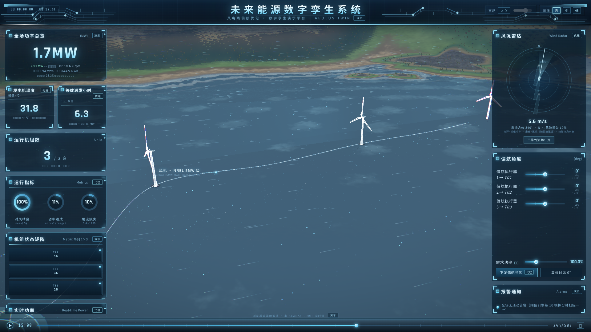

<!-- page -->

## 3.2 3×3 留档视图

3×3 布局为项目前期九机研究场景的留档形态（留档 tag `twin-3x3-archive-20260919`），保留可运行状态用于对比与回归。

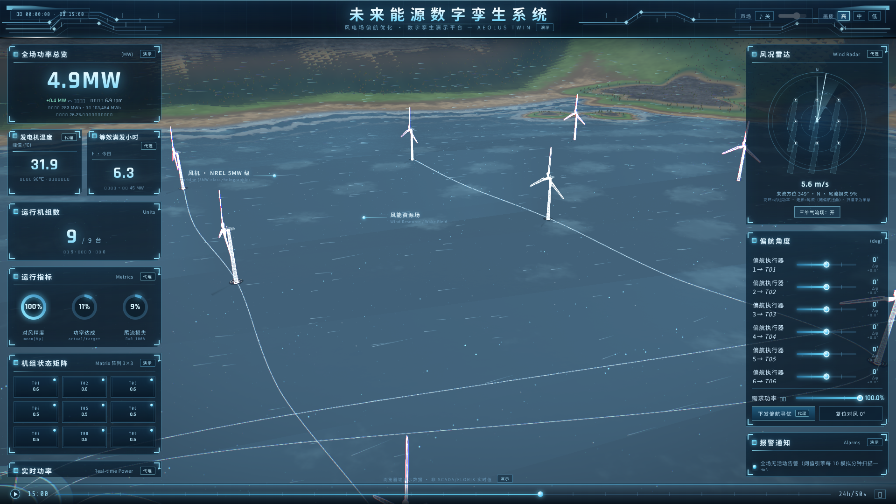

<!-- page -->

## 3.3 HUD 模块说明

| 模块 | 内容 | 数据来源 |
|---|---|---|
| 全场功率总览 | 全场总功率（MW）与偏差 | 场景仿真（尾流+功率曲线） |
| 发电机温度 | 代理温度（℃）与限值 | 运行模型代理值 |
| 等效满发小时 | 当量满发小时（h） | 运行模型代理值 |
| 运行机组数 | 在线机组数（台） | 场景状态 |
| 运行指标 | 对风程度 / 功率达成 / 尾流损失三项百分比 | 场景仿真 |
| 机组状态矩阵 | 逐机位功率状态表（串列布局为 1×3 矩阵） | 场景仿真 |
| 实时功率 | 全场功率趋势（Real-time Power） | 场景仿真 |

## 3.4 时间轴与回放

时间轴真实 50 秒 = 模拟 24 小时。点击时间轴任意位置可跳转到任意模拟时刻；`?t=<秒>` 参数可锁定时刻并暂停，用于截图与对比取证。回放为确定性计算：同一时刻、同一参数的运行状态逐位一致。

<!-- page -->

# 四、布局切换

## 4.1 3×3 九机布局

3×3 布局为 9 台 NREL 5MW 级机组、3 行 3 列布置的留档场景。布局真值由 `layouts.ts` 单一真值源定义，场景、HUD、自检五处全部派生，切换布局不改任何渲染逻辑。

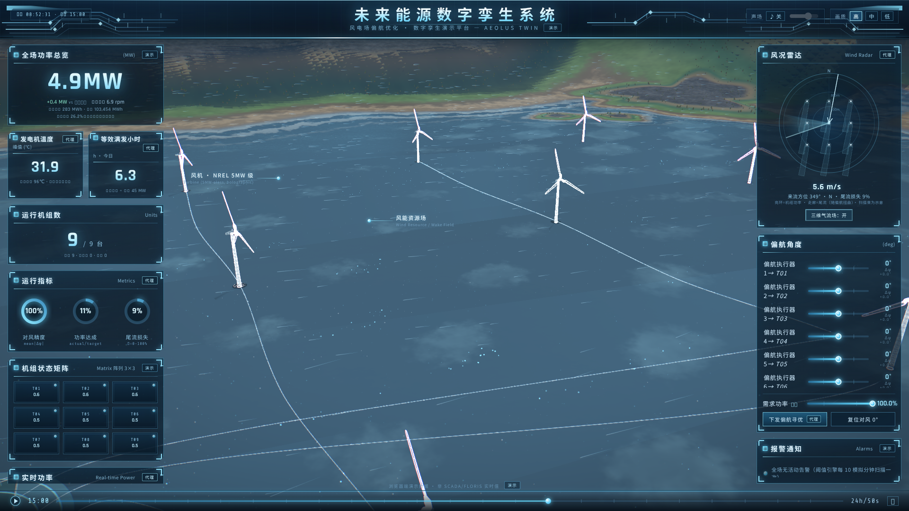

<!-- page -->

## 4.2 1×3 单列三机（串列）

1×3 布局为 3 台机组沿来流方向一字排开（串列）的优化演示工况，机位与参数如下：

| 机组 | 位置（m，x=东 y=北，FLORIS 系） | 角色 |
|---|---|---|
| T01 | (−100, 1272) | 上游（来流首台，最北） |
| T02 | (−100, 640) | 中游（受 T01 尾流） |
| T03 | (−100, 8) | 下游（受 T01/T02 尾流叠加，最南） |

机位为同一列（x = −100 m，即 3×3 场中列），沿主风向（北→南）串列，行距 632 m（= 5.02D）；与 41 工况 oracle（`docs/research/oracle/floris_gch_oracle_v1.json` 之 `tandem3.layout`）及演示界面 step-1 卡片（场景系 T01(x=−100,z=−1272) T02(x=−100,z=−640) T03(x=−100,z=−8)，+z=南）一致。

机组参数：NREL 5MW 级，轮毂直径 125.88 m，轮毂高度 90 m，额定功率 5000 kW。演示来流：风速 8 m/s、方位 0°（正北）、湍流强度 6%，处于该基准工况集的唯一验证范围内，界面会明确显示输入范围，超出时提示用户。

## 4.3 布局与留档约定

3×3 布局随 tag `twin-3x3-archive-20260919` 留档，代码与数据不删除、不改写；1×3 为新增演示布局。两布局共用同一物理内核与同一套自检断言（自检断言按布局选择对应真值）。

<!-- page -->

# 五、机组与尾流可视化

## 5.1 机组细节与尾流偏转

下图为 1×3 串列布局的特写机位。可观察到：上游机组 T01 的尾流沿来流方向衰减与扩散；当机组施加偏航角（yaw）后，尾流整体横向偏转，中游机组脱离尾流中心区，功率恢复——这正是航向角优化（wake steering）的物理机制。

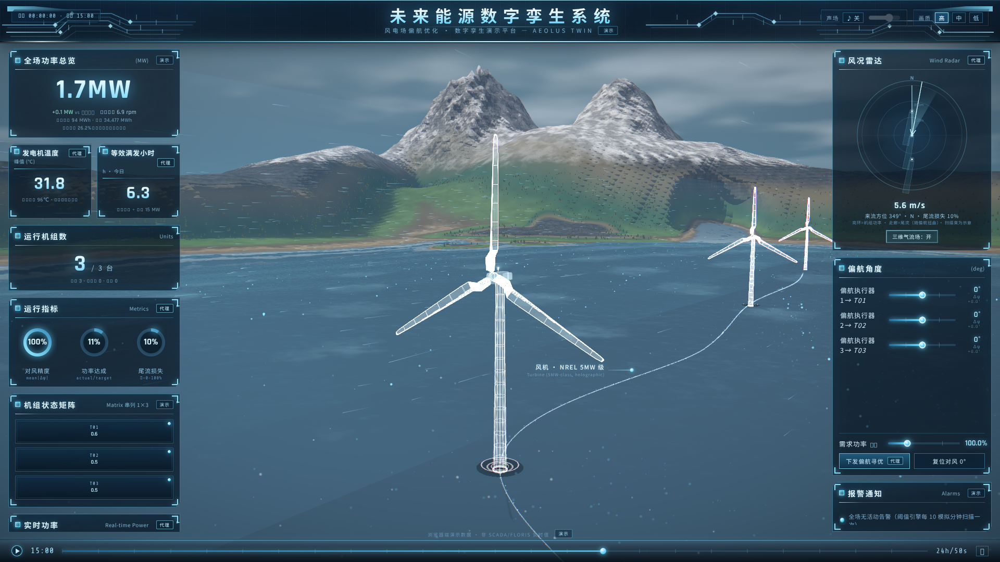

<!-- page -->

## 5.2 轮毂高度流场

物理内核在每台机组的轮毂高度平面（z = 90 m）上解算风速场 u(x, y) 与等效受力面积。演示界面的「流场」图件即该平面的离散着色（33×33 采样格），蓝色越深代表风速越低（尾流核心区）。

流场结果由 GCH 高斯尾流模型计算，模型逐式移植自 FLORIS 4.6.6 开源实现（BSD-3 协议），并经 41 工况全字段对拍验证（最大单台功率差 1.25×10⁻¹² kW，见第八章）。场景内的尾流动画为演示用可视化近似，精确数值以流场图件与导出数据为准。

<!-- page -->

# 六、渲染质量

## 6.1 画质三档

本软件提供 low / medium / high 三档渲染质量（`?q=` 锁定，或按帧率自动降档）。实测渲染规模（2026-10-05 重测）：

| 档位 | 绘制调用（次/帧） | 三角形 1×3 | 三角形 3×3 |
|---|---|---|---|
| high | 267 | 549,556 | 586,756 |
| medium | 264 | 529,864 | 567,064 |
| low | 231 | 440,060 | 440,060（两布局同） |

下图为 low 档 1×3 视图（与 3.1 节 high 档对照可见粒子密度与远景细节差异）。

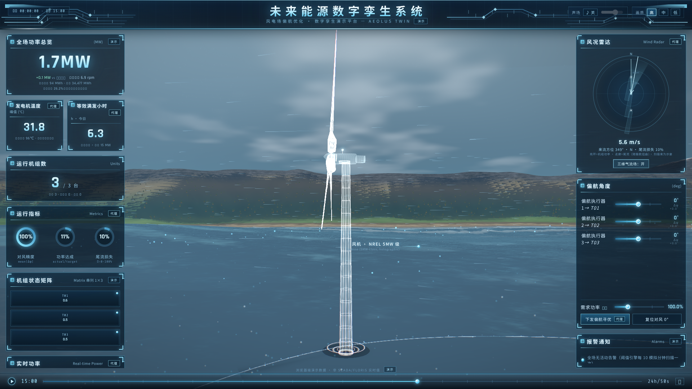

<!-- page -->

## 6.2 取证冻结（?freeze=1）

渲染相位冻结用于取证与对比：开启后场景时钟与粒子相位固定，同一 URL 的两次渲染逐像素一致。该参数是本项目所有对比截图（round41/42/44）的可复现基础，生产演示默认关闭。

<!-- page -->

# 七、航向角优化演示（七步流程）

## 7.0 演示入口与数据源

演示入口：`?demo=1&layout=1x3`，右侧滑出演示面板。演示采用 **41 个独立测试工况**（≥5 档、七档取 20 个）：

| 工况族 | 数量 | 说明 |
|---|---|---|
| 基准 · 零偏航 | 1 | 三机 yaw = [0, 0, 0] |
| 统一偏航 | 13 | 三机同角，−30°…+30°，5° 步 |
| 上游单台扫描 | 13 | 仅 T01 偏航，−30°…+30°，5° 步 |
| 中游单台扫描 | 13 | 仅 T02 偏航，−30°…+30°，5° 步 |
| 逐机贪心最优 | 1 | 求解结果 [30, 25, 0] |

每个工况同时持有两条数据：**代理** = 本软件内置 GCH 内核实时推理；**参考** = FLORIS 4.6.6 基准真值（构建期打包）。七步流程逐步如下。

<!-- page -->

## 7.1 第一步 · 选择工况

面板展示来流条件（风速/方位/湍流强度）并明确标注验证范围；展示坐标系（x=东、y=北、z=上；与 FLORIS 系 y=北 的映射关系）、单位与机组参数；下方为 41 工况计划格，可点击预置工况。

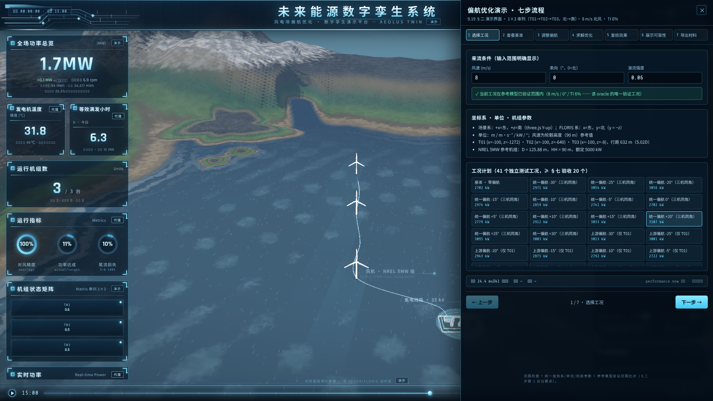

操作：确认来流在验证范围内（绿色提示），或直接进入下一步。

<!-- page -->

## 7.2 第二步 · 查看基准

展示零偏航基准：全场 2702.2 kW，逐台 T01 1754.0 / T02 439.0 / T03 509.2 kW；展示基准轮毂高度流场（SVG 图件，可导出）。中游 T02 处于 T01 尾流核心区，功率显著低于上游，说明优化空间所在。

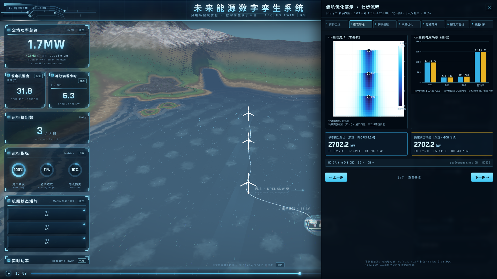

<!-- page -->

## 7.3 第三步 · 调整航向

三台机组各配一个航向角滑块（执行量程 ±30°，步长 5°），另有「统一偏航」快捷操作。拖动滑块时，场景内机组偏航、尾流偏转，面板同步刷新代理（内核）与参考（FLORIS）两条结果——两者逐式对拍，界面直接展示一致性。

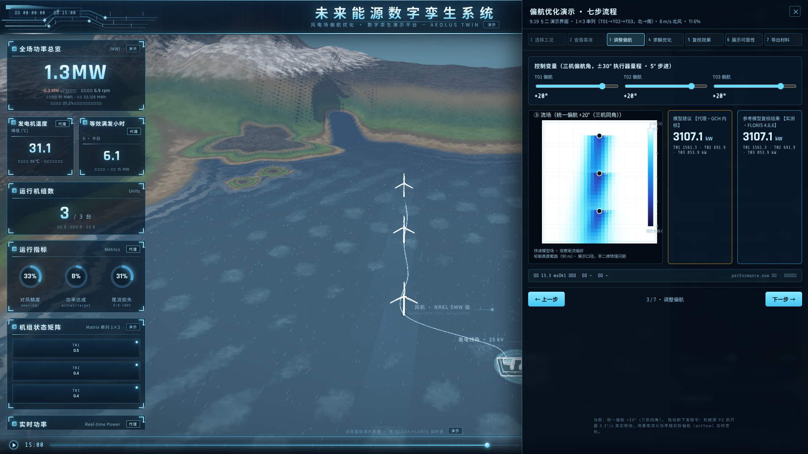

<!-- page -->

## 7.4 第四步 · 求解优化

内置逐机贪心求解器：按「上游 → 中游 → 下游」顺序，对当前机组在 ±30°、5° 步内扫描取最优，锁定后进入下一台。求解过程表展示三阶段：T01 定 [30, 0, 0] → 3060.0 kW；T02 定 [30, 25, 0] → 3299.8 kW；T03 保持 0°。

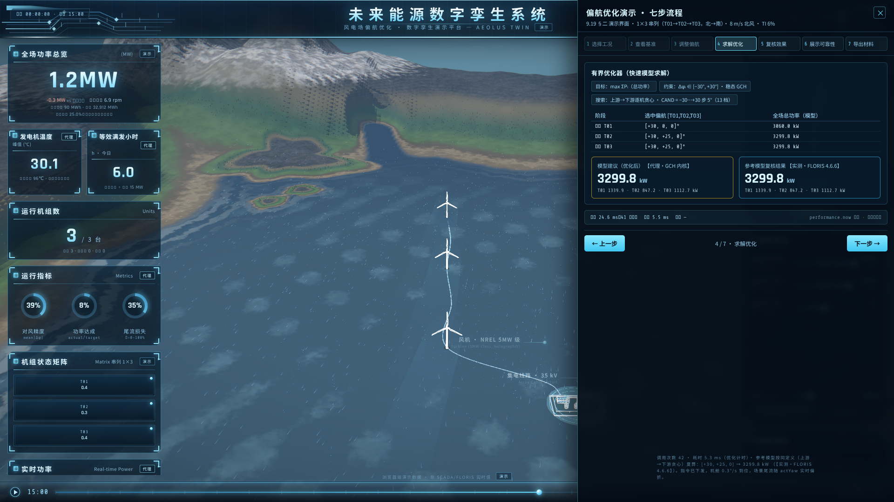

<!-- page -->

## 7.5 第五步 · 复核效果

并排展示基准/优化两幅轮毂高度流场（尾流横向错开直观可见）；逐台功率柱状对比：T01 1754→1340 kW（上游让渡）、T02 439→847 kW（中游恢复）、T03 509→1113 kW（下游恢复）；全场 2702.2 → 3299.8 kW，**增益 +597.5 kW（+22.11%）**；逐台有效风速 uEff 7.97 / 6.64 / 6.83 m/s。

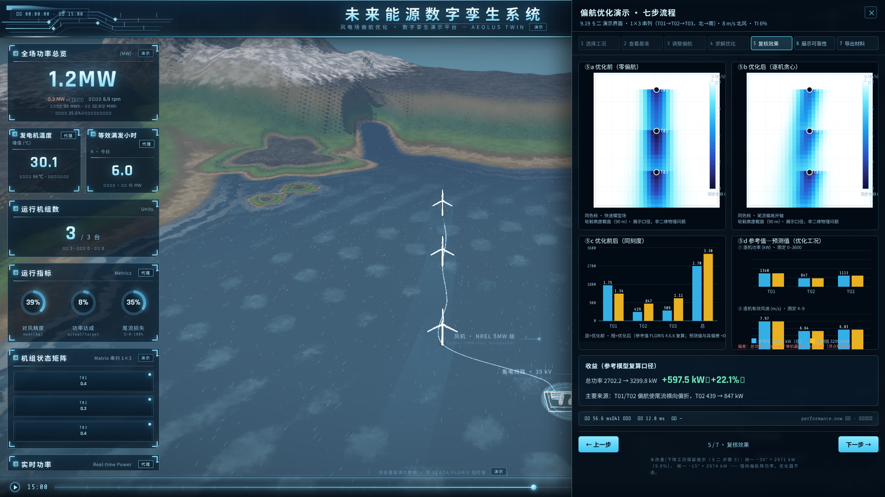

<!-- page -->

## 7.6 第六步 · 展示可靠性

展示三组可靠性证据：① 41 工况「参考值-预测值」散点（全部落在 45° 参考线上，覆盖 2650–3500 kW）；② 对数坐标功率误差散点（最大单工况偏差 10⁻⁹ kW 量级）；③ 推理/优化/复核三段真实计时（本次演示约：推理 27–37 ms、优化 5–23 ms、41 工况复核 ~229 ms）。测试集、误差定义与模型版本以卡片形式明示。

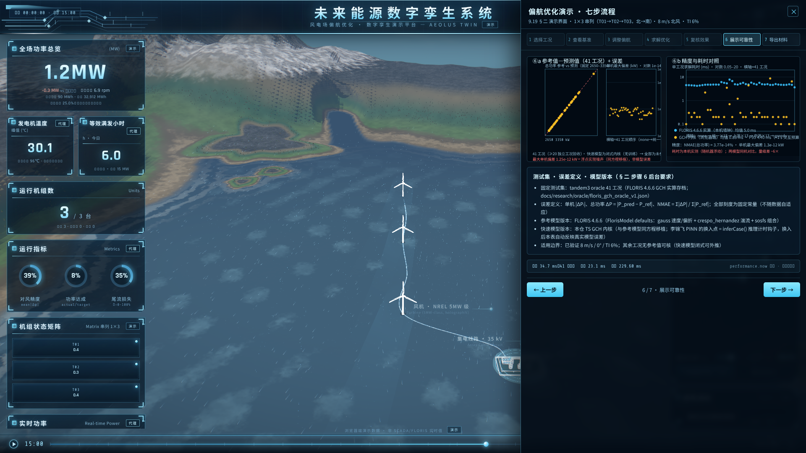

<!-- page -->

## 7.7 第七步 · 导出材料

两项导出：① **工况记录 JSON**——case 编号、数据来源、配置（布局/来流/机组参数）、41 工况全部结果（参考/代理/误差）与四类计时字段，可追溯、可再分析；② **四张对比图 SVG 逐张导出**（流场对比/功率对比/参考-预测散点/耗时对照），SVG 矢量格式可直接嵌入报告与 PPT。

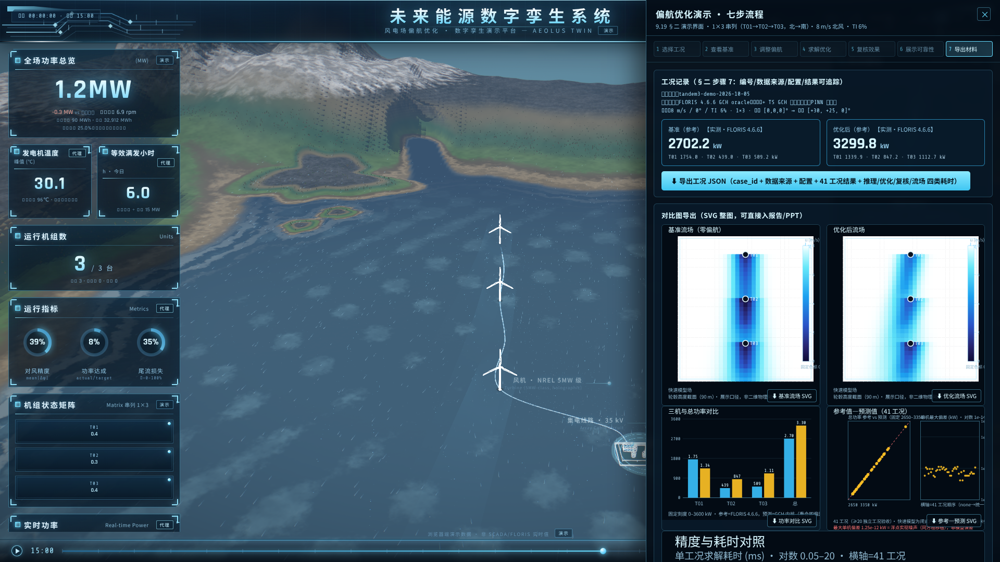

<!-- page -->

# 八、数据与验证

## 8.1 基准数据（oracle）

演示参考值来自 FLORIS 4.6.6 开源风场模拟框架，按其 GCH 高斯尾流模型、NREL 5MW 机组曲线、本文 1×3 机位与来流条件生成的 41 工况真值，构建期打包进前端（文件 `floris_gch_oracle_v1.json`，仓库内 sha256 可核验）。参考值字段：逐台功率、全场功率、轮毂平面风速、等效受力面积、有效风速。

## 8.2 内核对拍

本软件 GCH 内核为 FLORIS 4.6.6 GCH 实现的逐式移植，移植完成后以 41 工况全字段对拍验证：最大单台功率差 **1.25×10⁻¹² kW**（相对量级 10⁻¹³），有效风速最大差 4.8×10⁻¹³ m/s，平均绝对百分比误差（NMAE）≈ 3.8×10⁻¹⁴ %。对拍作为常驻自检（断言 161 项，3×3 布局全绿；1×3 布局 158 项全绿）随每次构建执行。

## 8.3 质量门禁

本软件研发侧设三道质量闸：静态检查（lint，0 警告 0 错误）、功能自检（161 项断言，含布局守卫、内核对拍、流场结构断言）、生产构建。三闸全绿为发布前置条件。

<!-- page -->

## 8.4 开源依赖声明

本软件物理内核中的 GCH 高斯尾流模型逐式移植自 FLORIS 4.6.6（BSD-3 协议，https://github.com/ornl/FLORIS），移植后与原版全量对拍验证（§8.2）。其余模块（三维场景、HUD、七步演示、布局系统、音频、自检体系）均为原创。

## 8.5 数据来源声明

本软件演示数据为 FLORIS 4.6.6 数值模拟生成的基准真值，**不含任何真实 SCADA 场站数据**；`?ws=` 真实数据外挂默认关闭，仅作为可选接口保留。

# 九、常见问题

**Q1 界面提示「当前工况不在已验证范围」？** 演示数据仅在 8 m/s / 0° / TI 6% 基准工况集内验证。请回到第一步选择预置工况，或等待数据扩展。

**Q2 画面卡顿？** 加 `?q=low` 降档；软件也会按帧率自动降档。核显/软渲染建议使用 low 档。

**Q3 演示面板没出现？** 须同时满足 `?demo=1` 与 `?layout=1x3`（演示固定 1×3 串列工况）。

**Q4 截图与现场演示数字不一致？** 场景 HUD 展示的是「场景仿真」的实时代理值（含风场动画扰动）；演示面板与导出的数字来自内核精确解算与基准对拍，以面板与导出为准。

**Q5 导出的 SVG 在 PPT 里模糊？** 不会。SVG 为矢量格式；若目标环境不支持 SVG，可用浏览器另存 PNG（3 倍分辨率）。

**Q6 如何复现某张截图？** 截图 URL 含 `?t=`（时刻）`?cam=`（机位）`?freeze=1`（相位冻结）`?q=`（画质）四参数，同 URL 两次渲染逐像素一致。

<!-- page -->

# 附录 A · 41 工况明细

| # | 工况 ID | 配置（yaw T01/T02/T03，°） | 参考总功率区间（kW） |
|---|---|---|---|
| 1 | none | 0 / 0 / 0 | 2702.2 |
| 2–14 | unified−30 … unified+30 | θ / θ / θ（θ = −30…+30，5° 步） | 2702.2–3107.1 |
| 15–27 | up−30 … up+30 | θ / 0 / 0（θ = −30…+30，5° 步） | 2702.2–3060.0 |
| 28–40 | mid−30 … mid+30 | 0 / θ / 0（θ = −30…+30，5° 步） | 2702.2–2874.6 |
| 41 | greedy | 30 / 25 / 0 | 3299.8 |

逐工况完整数值（参考/代理/误差/计时）以演示第七步导出的 JSON 为准（case 编号、配置、数据来源全部随包）。
