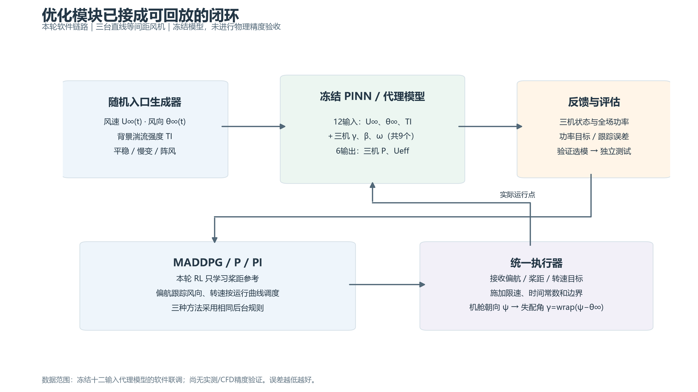
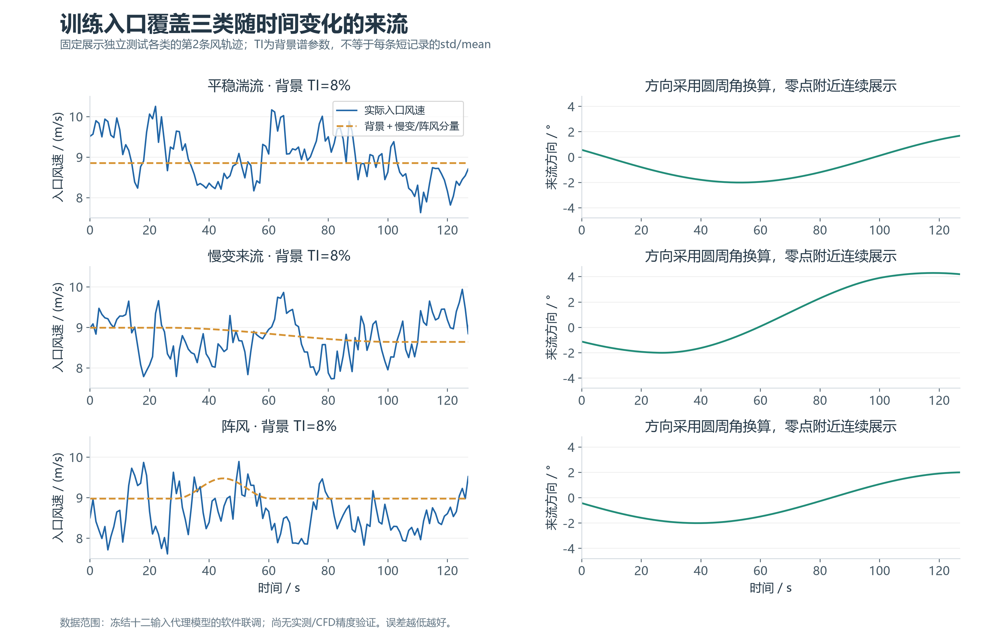
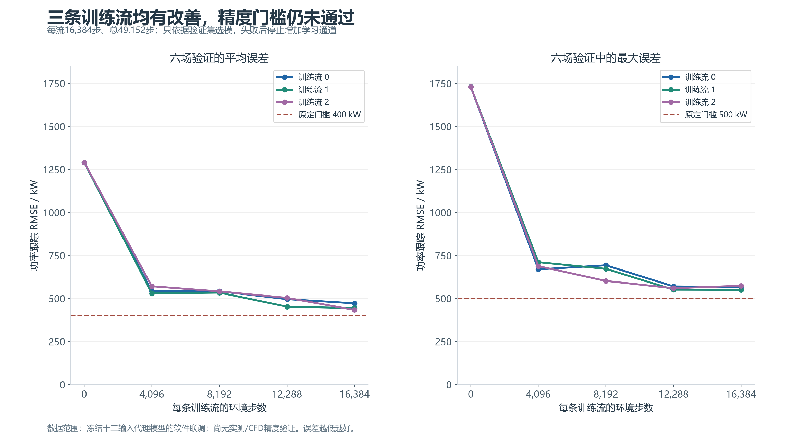
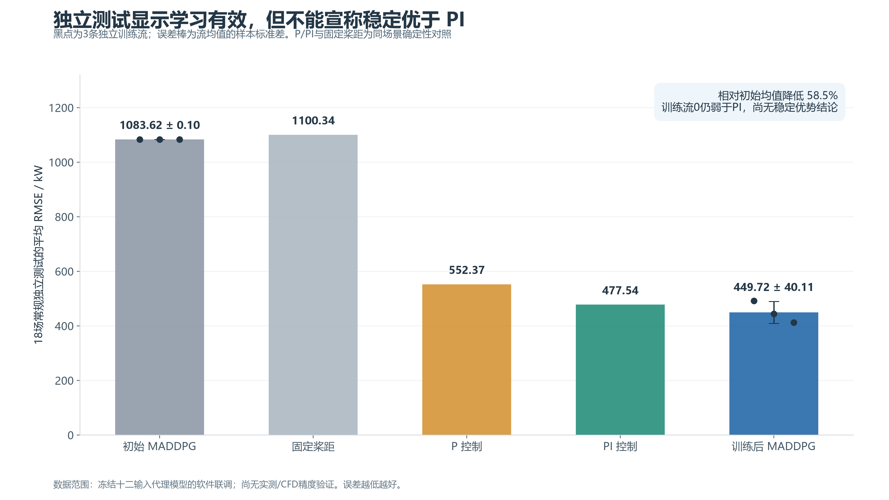
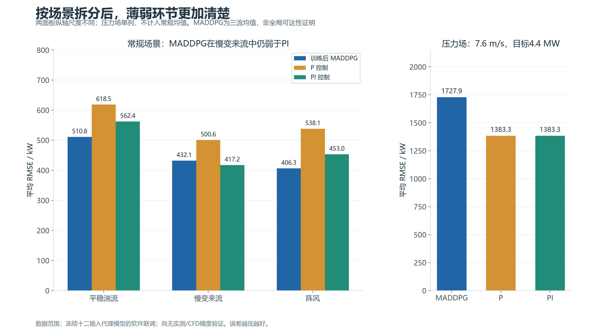
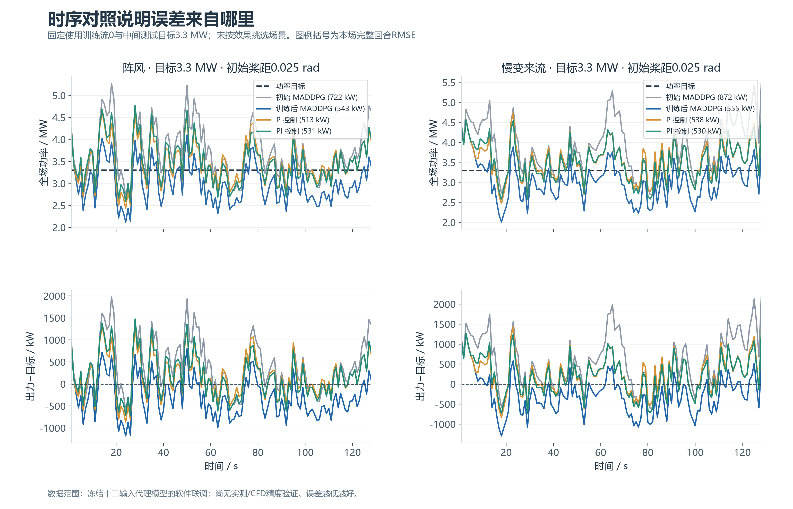
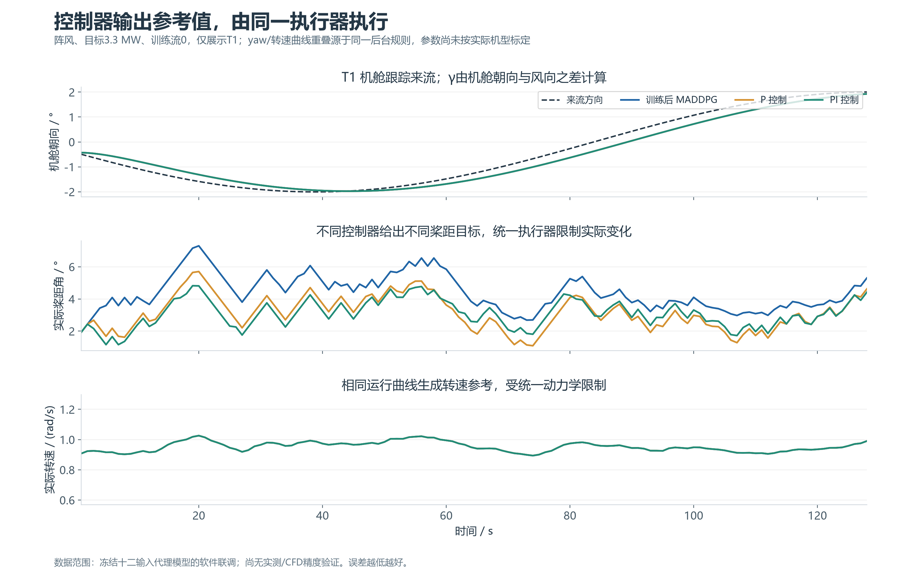

# 中期答辩图表及讲解稿

全部图片由 `midterm_figures.py` 使用 Python/Matplotlib 从冻结实验 CSV 绘制，没有使用 AI 图像生成。每图同时提供 PNG（220 dpi）、PDF、SVG。建议正文用图01、02、03、04、06，图05和07用于局限分析及答辩追问。

数据来源：2026-10-22 十二输入代理模型随机入口实验。三台直线等间距风机；主种子42派生三条独立训练流，各16,384步。当前优先跑通软件闭环，PINN训练副本仍采用合成标签，不能据此宣称真实风场精度或真实发电收益。本组图不将旧九输入模型与新模型结果放在同一性能比较中。

## 图01：优化闭环与接口



**读图与意义：** 上部展示随机入口、代理模型及反馈；下部展示控制器和统一执行器。代理模型外部输入为风速、风向、TI及三机各自的偏航失配角、桨距角、转速，共12维；输出为三机功率与有效风速，共6维。它说明接口和职责已经接通，优化器有了可训练、可评估、可回放的对象。

**建议讲解：** “我完成的是优化闭环：把随机来流接到队友模型，使用相同执行器比较学习控制和传统控制。本轮先让MADDPG只学习桨距，偏航和转速采用共同后台规则。”

**边界：** 这是软件数据流示意，不是完整流场仿真或物理精度证明；本轮没有让RL同时学习三个通道。

## 图02：三类随机入口



**读图与意义：** 左列是实际风速和背景加事件分量，右列是风向，三行分别为平稳湍流、慢变和阵风。固定选择各类独立测试的中间目标所对应风轨迹，未挑选“最好看”的记录。它说明环境已经使用随时间变化的入口，而不是只在固定风下训练。

**建议讲解：** “随机入口包含湍流波动、慢变化与阵风，同时给模型传入风向和背景TI。我们先把入口限制在当前模型的约定范围，建立可重复的场景库。”

**边界：** Kaimal单点入口并非TurbSim全场风，不包含完整空间相干结构；TI为背景谱参数，短记录的总标准差/均值不必等于TI。图中方向已换算为零点附近连续角度。风速包络拒绝采样也会影响有限记录统计。

## 图03：训练改善与晋级门槛



**读图与意义：** 三条线表示独立训练流，左图是六场验证的平均RMSE，右图是六场中的最大RMSE；横轴是每流环境步数。两条虚线分别为原定400/500 kW门槛。训练均值从约1290 kW下降至471.79、444.14、433.65 kW，但三流均未达到完整精度门槛。

**建议讲解：** “三次训练都确实学到了降低误差的行为，但精度尚未达到预先设定标准，因此我没有直接增加转速和偏航的学习难度。当前是学习有效，完整能力验收仍未通过。”

**边界：** 这是验证曲线而非训练奖励或独立测试曲线；只在保存的4096步间隔评估。最终检查点恰好也是本轮验证最佳，不证明更长训练仍然稳定，也不等于已经收敛。

## 图04：统一基线下的独立测试



**读图与意义：** 每条训练流先在18场常规测试上分别求完整回合RMSE，再对这些场景RMSE取平均；MADDPG柱高是三个流均值的平均。黑点对应三个流，误差棒是三个流均值的样本标准差，不是置信区间。P、PI和固定桨距各使用相同场景、后台调度与执行器，仅计算一次确定性对照。

| 控制方法 | 常规平均RMSE / kW |
|---|---:|
| 初始 MADDPG | 1083.62 |
| 固定桨距 | 1100.34 |
| P 控制 | 552.37 |
| PI 控制 | 477.54 |
| 训练后 MADDPG | 449.72 |

**建议讲解：** “训练后平均误差为449.72±40.11 kW，相对初始的1083.62 kW下降58.5%。平均值略低于PI，但三次训练中仍有一次弱于PI，所以目前不能宣称稳定或统计显著优于PI。”

**边界：** 测试目标2.7/3.3/3.9 MW和测试风轨迹在选模后启用，压力场不计入本均值。此指标不是所有时间点混合计算的一次RMSE，也不是功率预测精度。

## 图05：分风况表现与压力场



**读图与意义：** 左侧拆分平稳湍流、慢变和阵风；右侧单列固定7.6 m/s、4.4 MW的低风高目标场景。两个面板纵轴不同。MADDPG在慢变场景仍弱于PI（432.08对417.19 kW），压力场也更差（1727.89对1383.30 kW）。

**建议讲解：** “总体均值会掩盖失效场景。我保留了慢变和低风高目标的结果，下一步重点解决欠功率行为和目标响应，而不是仅通过增加控制通道追求更低平均值。”

**边界：** 压力场是固定风，不能称为湍流测试。有限稳态候选扫描显示采样能力缺口，但没有全局功率上界证书，不能把全部跟踪损失都解释成物理不可达。

## 图06：功率跟踪与有符号误差



**读图与意义：** 上排是全场功率与3.3 MW目标，下排为“出力−目标”，正值为过发、负值为欠功率。左右分别为阵风与慢变。固定展示第0训练流、初始桨距0.025 rad及测试各类第2条风轨迹；图例中的RMSE只针对本场，不与18场总体均值混淆。

**建议讲解：** “柱状图说明总体误差，时序图进一步显示误差发生在什么时候、表现为过发还是欠功率。这里展示了固定规则选出的场景，包括MADDPG仍表现不理想的部分。”

**边界：** 单场曲线不能替代多场、多随机流统计；并且第0流是预先固定的展示选择，不代表最佳策略。

## 图07：统一执行器的实际运行点



**读图与意义：** 展示同一阵风场T1的机舱朝向、实际桨距与实际转速。机舱跟踪来流方向，偏航失配由两者之差计算。三种控制器的yaw和转速轨迹重叠源于相同后台规则；桨距则由各自功率控制决定，经过同一执行器产生实际运行点。

**建议讲解：** “算法不直接瞬间改变物理状态，而是给出目标值，再由统一执行器施加速率、时间常数与运行边界。这保证P、PI与MADDPG的控制权限和约束一致。”

**边界：** 图中只展示T1的一个场景。完整训练转移审计在上一轮已完成；当前执行器参数是联调假设，不是实际机型标定值。图中的后台转速参考不由RL学习。

## 答辩可使用的结论

“已完成三机优化的软件闭环、随机来流训练、统一传统控制基线、多随机流验证与冻结独立测试。MADDPG能明显降低初始策略的功率跟踪误差，但跨训练流可靠性、慢变跟踪与低风高目标表现尚未达到预设要求。当前以接口和流程验证为主，真实物理精度及发电收益有待仿真或实测数据验证。”

不宜写“已实现真实风场高精度预测”“MADDPG全面优于PI”“三通道协同优化已稳定收敛”。本轮没有新增训练、调参或读取测试后再修改策略。

## 复现与数据核验

从项目根目录运行：

```powershell
.venv\Scripts\python.exe -B -X utf8 -m optimization_control.maddpg_wind_farm.midterm_figures --output optimization_control/experiments/20261022_midterm_figures_new
```

输出目录必须不存在，旧图不会自动清理。`config.yaml`记录输入文件摘要和展示选择，`metrics.csv`提供图03至05的绘图数值，`validation.json`记录240条测试RMSE复算与来源检查。原始实验、模型及检查点不被修改。
