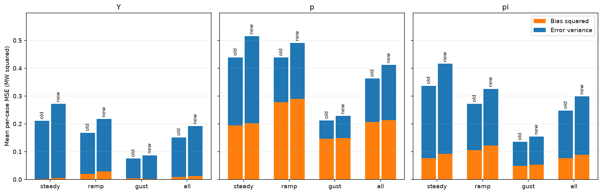
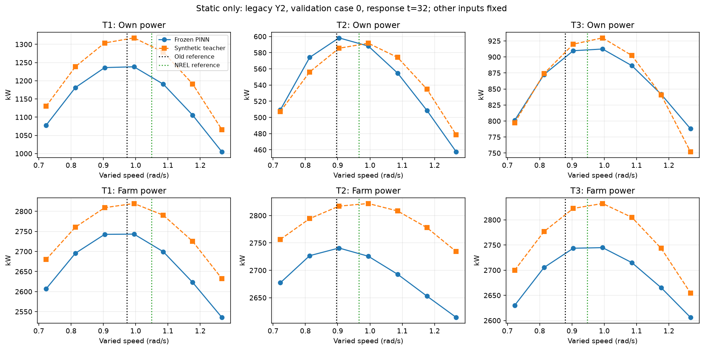

# 转速迁移归因诊断：误差波动与代理响应限制（2026-11-06）

**本轮支持先明确代理的转速响应适用范围，暂不启动控制重训。** 60个已存闭环回合的Y误差增量主要位于误差方差项；固定其他输入的48点静态对照中，代理对新参考的全场功率方向与原合成标签仅12/48一致。实际点的P／Ueff重放48/48逐值相等，单位、输入排序和来源路径通过核对。

保留用户指定NREL参考和新边界，未回滚曲线、改父策略、调P／PI或修改PINN。新增1440行PINN输入，与上轮4030行分别记账，合计5470；环境推进、训练、优化器更新、新风均0。

## 冻结点与重放

按先行协议固定旧／新Y2 selected和PI、全部六条validation、响应t=32／96，共48点。每点1行实际重放＋2行三机基础参考替换＋3×7行单机网格＋6行±.01局部扰动，全部30请求唯一；48个scope全部完成，PINN调用96次、输入1440行，无失败或重试。

入口U／theta／TI、实际pitch／gamma和机位固定。gamma由保存实际失配角取得，并与heading−来流方向交叉核对。模型P与Ueff均重新输出。实际点最大功率、Ueff、全场功率重放误差均为0，优于事前2W／2e-5m/s／6W容差。

旧／新基础参考各自使用该响应行保存的Ueff生成一次；三机直接替换为基础参考，不添加C残差，不把预测出的新Ueff代回迭代。这是静态反事实，不是当前策略下一步动作、执行器可达点或稳态闭环。旧参考48点均未低于新允许下限；网格下端按float32向范围内取值。

## 60回合误差分解

e=P_farm−target，非reset128步。先对每回合计算MSE=mean(e)^2+var(e,ddof=0)，再对case与三父等权。以下bias²是“每回合bias平方的均值”，方差是“每回合误差方差的均值”；没有将平均RMSE平方当平均MSE，也没有将平均signed bias再平方冒充bias²。单位为kW及kW²。

| 方案／版本 | signed bias kW | 平均bias² | 平均误差方差 | 平均MSE | 过发% | 欠发% |
|---|---:|---:|---:|---:|---:|---:|
| Y legacy | 55.710987 | 8953.868 | 142206.380 | 151160.248 | 54.167 | 45.833 |
| Y nrel | 86.363260 | 11806.443 | 180302.612 | 192109.055 | 55.903 | 44.097 |
| p legacy | 441.097866 | 206258.563 | 156683.096 | 362941.659 | 88.021 | 11.979 |
| p nrel | 449.593263 | 213489.440 | 198116.677 | 411606.117 | 85.547 | 14.453 |
| pi legacy | 267.561074 | 76722.686 | 171182.228 | 247904.914 | 74.349 | 25.651 |
| pi nrel | 288.497417 | 88946.231 | 209707.450 | 298653.681 | 73.828 | 26.172 |

| 方案 | ΔMSE | Δbias² | Δ误差方差 | bias²增量占比 | 方差增量占比 |
|---|---:|---:|---:|---:|---:|
| Y | 40948.807 | 2852.576 | 38096.231 | 6.966% | 93.034% |
| p | 48664.458 | 7230.877 | 41433.582 | 14.859% | 85.141% |
| pi | 50748.766 | 12223.545 | 38525.221 | 24.086% | 75.914% |

Y的MSE增加40948.807，其中38096.231来自方差项（93.034%），2852.576来自bias²项（6.966%）。新增过发MSE为33629.482，欠发为7319.325，两侧都保留。PI的方差／bias²占比为75.914%／24.086%。这些是MSE的代数分解比例，不是RMSE增量比例，也不是各物理机制的因果贡献。

bias²包含每回合正／负均值偏差的平方，不专指过发；过发／欠发MSE另外按误差符号分列。全部回合恰好等于目标的比例为0，因此下表欠发比例变化与过发比例变化互为相反数，完整两侧比例保存在逐回合和分组CSV。

| 方案 | 风况族 | Δsigned bias kW | Δbias² | Δ方差 | ΔMSE | Δ过发比例（百分点） |
|---|---|---:|---:|---:|---:|---:|
| Y | stationary | 22.684604 | 2459.334 | 59280.732 | 61740.067 | 1.172 |
| Y | ramp | 30.328548 | 8118.814 | 41209.420 | 49328.234 | -0.911 |
| Y | gust | 38.943666 | -2020.422 | 13798.542 | 11778.120 | 4.948 |
| p | stationary | 10.446263 | 7589.102 | 69163.903 | 76753.005 | -3.125 |
| p | ramp | 11.090442 | 11795.791 | 41044.279 | 52840.071 | -1.562 |
| p | gust | 3.949487 | 2307.737 | 14092.562 | 16400.299 | -2.734 |
| pi | stationary | 26.047054 | 14961.629 | 63988.310 | 78949.939 | -1.953 |
| pi | ramp | 24.237480 | 16441.763 | 37434.940 | 53876.703 | 0.000 |
| pi | gust | 12.524496 | 5267.243 | 14152.413 | 19419.656 | 0.391 |

阵风Y的signed bias增加38.944 kW，但逐回合bias²均值下降2020.422；方差增加13798.542，合成MSE增加11778.120。不同回合的正负偏差不能先相互抵消后再平方。PI总体正偏差增加20.936 kW，过发比例反而从74.349%降至73.828%，说明过发比例和过发幅度也要分开。

闭环Y的平均RMSE仍是377.392→424.180 kW，和上一轮一致；本表MSE151160.248→192109.055开方得到的是合并MSE口径的RMSE，不替换原“回合RMSE均值”口径。逐回合60行、30配对以及三父离散分组均保存在CSV。



## 固定其他输入时，新参考提高还是降低功率

48点三机同时由旧基础参考换为新基础参考，代理全场ΔP均值−8.449993 kW：12点增加、36点降低，范围−28.140938～+33.370125 kW。原合成标签48点全部增加，均值+23.131036 kW。因此不能用“新参考必然提高模型功率”概括这组锚点。

| 输出机组 | 代理平均ΔP kW | 标签平均ΔP kW |
|---|---:|---:|
| T1 | -27.748121 | -21.003086 |
| T2 | 5.841906 | 16.714393 |
| T3 | 13.456221 | 27.419729 |
| 全场 | -8.449993 | 23.131036 |

联合替换时，两者均表现为T1损失、T2／T3增益，但幅值和耦合不同，合计全场方向出现分歧。不能把这一结果简化为所有单机方向都相反。

| 锚点来源 | 风况族 | 点数 | 代理平均ΔP kW | 标签平均ΔP kW | 代理增加／降低 |
|---|---|---:|---:|---:|---|
| Y2_selected | stationary | 8 | -12.544945 | 16.172734 | 2／6 |
| Y2_selected | ramp | 8 | -20.097062 | 15.737422 | 0／8 |
| Y2_selected | gust | 8 | -16.891547 | 16.594566 | 0／8 |
| Y2_selected | overall | 24 | -16.511185 | 16.168241 | 2／22 |
| pi | stationary | 8 | 5.902023 | 32.492648 | 4／4 |
| pi | ramp | 8 | -6.033188 | 27.037734 | 2／6 |
| pi | gust | 8 | -1.035242 | 30.751109 | 4／4 |
| pi | overall | 24 | -0.388802 | 30.093831 | 10／14 |
| all | stationary | 16 | -3.321461 | 24.332691 | 6／10 |
| all | ramp | 16 | -13.065125 | 21.387578 | 2／14 |
| all | gust | 16 | -8.963395 | 23.672838 | 4／12 |
| all | overall | 48 | -8.449993 | 23.131036 | 12／36 |

旧状态锚点总体为−8.022143 kW，新状态锚点为−8.877844 kW；各自24点均是6增加／18降低，差异并非只出现在新轨迹。改变omega后的Ueff重新预测且确实变化，三机的变化范围见ueff_reference_changes.csv，没有把Ueff输出固定为锚点值。

## 机组差异与标签方向

局部±.01比较共144对，使用实际float32间距；ΔP绝对值≤2 W为预定近零带。own方向130/144一致，farm方向124/144一致，但联合参考替换的方向只有12/48一致，局部方向一致不等于有限幅度三机联合响应可靠。

| 变化机组 | own方向一致 | farm方向一致 | 代理own斜率 | 标签own斜率 | 代理farm斜率 | 标签farm斜率 |
|---|---:|---:|---:|---:|---:|---:|
| T1 | 47/48 | 45/48 | -346.343 | -284.447 | -324.281 | -193.558 |
| T2 | 37/48 | 33/48 | 66.123 | 188.523 | -19.587 | 143.100 |
| T3 | 46/48 | 46/48 | 322.377 | 410.045 | 312.704 | 410.045 |

斜率单位kW/(rad/s)，是48锚点上的平均局部差分，不是全域单调性或最优点。T2差异最明显：缓变own／farm方向仅10/16与9/16一致，farm平均斜率−99.706，而标签为+89.749；稳态为+55.711对+185.440，阵风−14.765对+154.110。T1与T3也存在幅值／耦合差，不能只归因于一台机。

风况族分组同时包含不同目标和反馈后的pitch／gamma状态，只描述这些固定锚点的差异，不是单独操纵来流因素的因果试验。

全部锚点来流投影排序均为T1→T2→T3。在原标签假设中，T2转速对上游T1、T3对上游T1／T2的局部功率差分为0；代理对应平均斜率为−17.618、−6.952／−2.721 kW/(rad/s)。这是“标签中没有的响应”的软件证据，不是对真实风机上游影响的物理定论。完整3×3矩阵及432项逐点响应另存。

转速通道有可利用的作用，并非不敏感：单机7点扫描中，本机功率平均跨度T1／T2／T3约264.765／169.007／164.607 kW。模型和标签的采样最大位置存在差异，详见144行sampled_grid.csv；所有“最大”均只指该锚点、固定其他输入和7点网格的采样最大，不宣称最优TSR、全局最优或控制应追求该点。



图中竖线仅标示该机旧／新参考omega；曲线始终固定另两机的实际omega。三机同时替换参考的全场功率差由独立的两行反事实计算，不等于曲线与竖线交点的直接组合。

## 全部48点参考替换结果

以下ΔP均为新基础参考减旧基础参考，两者使用同一锚点，单位kW。标签不是物理真值。

| id | 源版本／控制器 | case | t | 代理ΔP | 标签ΔP |
|---|---|---|---:|---:|---:|
| 0 | legacy／Y2_selected | val_stationary_2850000 | 32 | -21.517063 | 11.743813 |
| 1 | legacy／Y2_selected | val_stationary_2850000 | 96 | -24.883125 | 6.465687 |
| 2 | legacy／Y2_selected | val_stationary_3450000 | 32 | -11.436750 | 20.336875 |
| 3 | legacy／Y2_selected | val_stationary_3450000 | 96 | 11.056250 | 24.274750 |
| 4 | legacy／Y2_selected | val_ramp_2850000 | 32 | -19.079250 | 10.663750 |
| 5 | legacy／Y2_selected | val_ramp_2850000 | 96 | -28.140937 | 7.824625 |
| 6 | legacy／Y2_selected | val_ramp_3450000 | 32 | -12.611125 | 21.155875 |
| 7 | legacy／Y2_selected | val_ramp_3450000 | 96 | -17.457687 | 21.728938 |
| 8 | legacy／Y2_selected | val_gust_2850000 | 32 | -19.907750 | 12.913156 |
| 9 | legacy／Y2_selected | val_gust_2850000 | 96 | -17.810125 | 9.658375 |
| 10 | legacy／Y2_selected | val_gust_3450000 | 32 | -11.106813 | 19.328187 |
| 11 | legacy／Y2_selected | val_gust_3450000 | 96 | -11.597312 | 17.428563 |
| 12 | legacy／pi | val_stationary_2850000 | 32 | -4.475812 | 27.598375 |
| 13 | legacy／pi | val_stationary_2850000 | 96 | -15.551250 | 14.150438 |
| 14 | legacy／pi | val_stationary_3450000 | 32 | 11.826313 | 39.534813 |
| 15 | legacy／pi | val_stationary_3450000 | 96 | 30.564000 | 47.283875 |
| 16 | legacy／pi | val_ramp_2850000 | 32 | -1.812938 | 30.324188 |
| 17 | legacy／pi | val_ramp_2850000 | 96 | -18.543000 | 15.503750 |
| 18 | legacy／pi | val_ramp_3450000 | 32 | 0.855625 | 34.635937 |
| 19 | legacy／pi | val_ramp_3450000 | 96 | -5.701250 | 26.630188 |
| 20 | legacy／pi | val_gust_2850000 | 32 | -4.957438 | 29.817375 |
| 21 | legacy／pi | val_gust_2850000 | 96 | -11.461625 | 19.960687 |
| 22 | legacy／pi | val_gust_3450000 | 32 | 9.946188 | 39.972500 |
| 23 | legacy／pi | val_gust_3450000 | 96 | 1.271437 | 32.277750 |
| 24 | nrel／Y2_selected | val_stationary_2850000 | 32 | -25.623000 | 11.382500 |
| 25 | nrel／Y2_selected | val_stationary_2850000 | 96 | -27.810688 | 4.597250 |
| 26 | nrel／Y2_selected | val_stationary_3450000 | 32 | -14.602562 | 21.275625 |
| 27 | nrel／Y2_selected | val_stationary_3450000 | 96 | 14.457375 | 29.305375 |
| 28 | nrel／Y2_selected | val_ramp_2850000 | 32 | -22.223250 | 13.962438 |
| 29 | nrel／Y2_selected | val_ramp_2850000 | 96 | -26.762000 | 6.446063 |
| 30 | nrel／Y2_selected | val_ramp_3450000 | 32 | -16.128438 | 22.909875 |
| 31 | nrel／Y2_selected | val_ramp_3450000 | 96 | -18.373812 | 21.207812 |
| 32 | nrel／Y2_selected | val_gust_2850000 | 32 | -22.845375 | 15.936188 |
| 33 | nrel／Y2_selected | val_gust_2850000 | 96 | -25.295188 | 13.202250 |
| 34 | nrel／Y2_selected | val_gust_3450000 | 32 | -12.477063 | 22.576313 |
| 35 | nrel／Y2_selected | val_gust_3450000 | 96 | -14.092750 | 21.713500 |
| 36 | nrel／pi | val_stationary_2850000 | 32 | -4.167688 | 27.934250 |
| 37 | nrel／pi | val_stationary_2850000 | 96 | -16.538812 | 13.394813 |
| 38 | nrel／pi | val_stationary_3450000 | 32 | 12.189312 | 39.860125 |
| 39 | nrel／pi | val_stationary_3450000 | 96 | 33.370125 | 50.184500 |
| 40 | nrel／pi | val_ramp_2850000 | 32 | -0.653375 | 31.324250 |
| 41 | nrel／pi | val_ramp_2850000 | 96 | -18.832000 | 15.330312 |
| 42 | nrel／pi | val_ramp_3450000 | 32 | 1.194813 | 34.949562 |
| 43 | nrel／pi | val_ramp_3450000 | 96 | -4.773375 | 27.603687 |
| 44 | nrel／pi | val_gust_2850000 | 32 | -4.070375 | 30.559500 |
| 45 | nrel／pi | val_gust_2850000 | 96 | -11.166500 | 20.336875 |
| 46 | nrel／pi | val_gust_3450000 | 32 | 10.724937 | 40.638875 |
| 47 | nrel／pi | val_gust_3450000 | 96 | 1.431437 | 32.445312 |

## 能解释到哪里

闭环Y的signed bias提高30.652 kW，说明同目标下平均模型功率提高；静态固定β／γ的参考替换却在36/48点降低功率，两者不矛盾。静态仅覆盖t32／96、固定其他输入、直接换基础参考；完整回合还包含反馈后的pitch／yaw变化、原C修正、执行器滞后和128步来流历史，且Ueff也随模型响应变化。静态差分不能充当完整闭环根因证明。

误差方差项包含来流和闭环瞬态，分解本身不能辨别控制延迟、状态补偿等因果机制。本轮没有增跑闭环消融，不能判定唯一根因。目标为限功率跟踪，RMSE增大不等于Cp效率下降；提高可用功率也可能增加过发误差。

原synthetic_labels以入口U构造旧speed最优假设clip(U/11.4×1.267,.6,1.267)，用合成提取因子及尾流系数生成P／Ueff；不是实测、CFD或物理真值。本次使用相同实际模型输入和机位，标签函数48次、1440输入行，单列费用；未修改函数、权重、模型域或执行器。其方向分歧说明当前代理对该控制响应的解释能力受限，不自动判定标签或代理哪一方代表真实风机。

本轮“域内”只表示通过登记的输入边界检查，不等于每个联合输入被训练数据充分覆盖或已完成物理验证。

## 唯一后续建议

**先明确当前代理的转速控制适用范围和响应验收条件，再决定是否做小预算控制适配。** 将本轮48点输入输出、三机联合方向及T2耦合差异作为冻结验收夹具，交由模型负责人核对其预期响应及可接受误差界。当前不以长训练强求收益，也不自动修改PINN、调P／PI、切换父策略或发布新风。用户指定NREL参考和新边界继续保留，旧失败与selected=initial身份不改写。

## 复现与产物

工作树.，协议提交9467cfc169156b58218aa37b707471019b4fb971，任务起点93370066992012c61bb9244912ee0481200abf1f。目录optimization_control/experiments/20261106_nrel_speed_diagnostic/独立于已完成4030行迁移目录。配置seed=42，独立硬限2048行／32MiB，合计硬限6078行。

所有阶段已执行，prepare／query／report采用独占产物，不对现有目录重复采样或覆盖账本。历史命令为：

```powershell
& './.venv/Scripts/python.exe' -B -X utf8 -m optimization_control.maddpg_wind_farm.nrel_speed_response_audit prepare
& './.venv/Scripts/python.exe' -B -X utf8 -m optimization_control.maddpg_wind_farm.nrel_speed_response_audit query
& './.venv/Scripts/python.exe' -B -X utf8 -m optimization_control.maddpg_wind_farm.nrel_speed_response_report
```

只读来源核对可调用nrel_speed_response_audit.context()，不构建模型。anchors.json和requests.npz冻结48点及30种语义请求映射，anchors/a*.npz保存实际输入、全部P／Ueff和标签输出；replay.csv、metrics.csv、queries.csv保留48重放／48参考对照／1440语义请求。

closed_loop_decomposition.csv／decomposition_paired_cases.csv／decomposition_groups.csv／decomposition_changes.csv保存全部60回合、30配对和等权聚合；local_response.csv／local_response_groups.csv／sampled_grid.csv／local_cross_response.csv保存144局部对、144网格及432跨机差分。model_budget.json、complete.json、saved_audit.json和最终清单记录预算、来源及复核。所有图只读取保存数据，原图和仅调整上边距的可读版本均保留。

本轮不重复扫描原1720项旧归档，不写共享状态或原实验目录；所有结论限于当前冻结代理的软件诊断，不是新独立测试、物理效率证书或新增学习收益。
