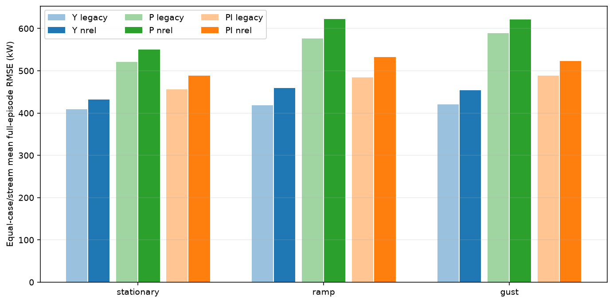
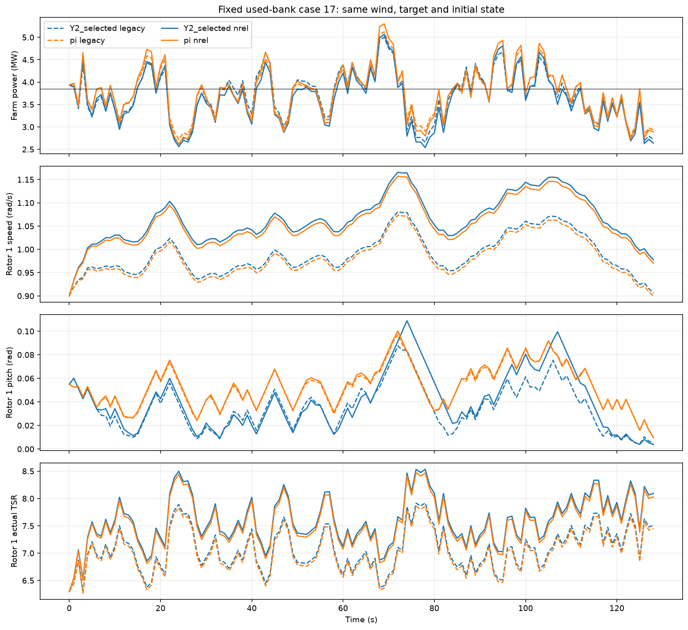

# NREL新规则：固定已用测试库回归与阶段收尾（2026-11-06）

**预定软件回归目标达成：新Y在三族风况平均完整回合RMSE均严格低于新共同PI，3/3通过，本阶段收尾。** 这是沿用18条已使用测试风的配置回归，不是新未见独立测试或新泛化证明。用户指定NREL曲线和新物理边界继续保留，不追加训练、消融、角色、网格、新风或模型精度前置任务。

固定Y selected新增步2048／0／2048，C父0／0／4096，原pitch父及forecast不变。仅按新规则执行五控制器×18风=90回合，旧相同90回合按原SHA与身份直接引用。目标2.75／3.35／3.85MW、初始pitch .025／.055rad、dt1s与128步均沿用原库，编号74000000…74000017。每族6条不同风，90回合不当作90条独立风。

## 主结果：完整回合RMSE

单位kW。每case先对128步计算RMSE，再对风和三条Y流等权，P／PI每条风各一次。Y与“pitch反馈＋yaw／speed调度”的比较是完整控制方案比较，不能当作新增通道单独学习收益。

| 版本 | 风况族 | Y | P | PI | Y−PI |
|---|---|---:|---:|---:|---:|
| legacy | stationary | 408.865521 | 520.568553 | 455.729720 | -46.864199 |
| legacy | ramp | 418.773016 | 576.780920 | 484.430224 | -65.657208 |
| legacy | gust | 420.991636 | 589.349409 | 488.138699 | -67.147063 |
| legacy | overall | 416.210058 | 562.232961 | 476.099547 | -59.889490 |
| nrel | stationary | 432.050552 | 549.743291 | 488.041868 | -55.991315 |
| nrel | ramp | 459.626697 | 622.074412 | 532.200097 | -72.573400 |
| nrel | gust | 454.080321 | 621.766122 | 523.087915 | -69.007594 |
| nrel | overall | 448.585857 | 597.861275 | 514.443293 | -65.857436 |

| 风况族 | Y新−旧 | P新−旧 | PI新−旧 | 新Y−新PI |
|---|---:|---:|---:|---:|
| stationary | 23.185031 | 29.174738 | 32.312148 | -55.991315 |
| ramp | 40.853681 | 45.293492 | 47.769874 | -72.573400 |
| gust | 33.088685 | 32.416713 | 34.949216 | -69.007594 |
| overall | 32.375799 | 35.628314 | 38.343746 | -65.857436 |

新Y总体448.585857kW、PI514.443293kW，差−65.857436kW。旧Y416.210058kW、PI476.099547kW，原差−59.889490kW。新设置相对PI的优势约扩大5.967947kW；Y自身相对旧设置误差增加32.375799kW，不能把通过回归判定写成曲线提升了绝对跟踪精度或新增学习收益。

90组新−旧配对中84组误差增加、6组降低；Y的54组中48增加、6降低。新Y相对同风新PI的54个策略／风配对有43组较低、11组较高，因此通过的是预定风况族均值，非每场保证。全部旧／新180行指标、90配对和54组Y−PI保留，不只报有利场景。



## 三流及原400／500kW门槛

| 冻结流 | 旧均值 | 新均值 | 旧最差 | 新最差 | 原精度门槛旧／新 |
|---|---:|---:|---:|---:|---|
| Y0_selected | 427.421068 | 460.597464 | 668.934658 | 704.392348 | False／False |
| Y1_selected | 431.279007 | 453.392309 | 657.106665 | 693.238816 | False／False |
| Y2_selected | 389.930098 | 431.767797 | 653.797768 | 690.161559 | False／False |

原精度定义为每流18回合均值≤400且最差≤500kW，两版本均0/3。该绝对门槛单列，不替代本轮已冻结的三族均值低于PI判断，也不据此继续训练。Y1仍selected=initial，C0／C1仍为初始speed头；本轮训练／更新0，不增加任何通道学习收益记录。本轮没有final新训练策略，不能生成或宣称新的后期训练稳定性曲线。

## 每回合偏差、方差与实际约束

各case先以e=P_farm−target计算bias、bias²和ddof=0误差方差，再等权聚合，检查MSE=bias²+variance。这里的平均bias²不是平均bias再平方，平均MSE也不是平均RMSE平方。完整180回合字段在metrics.csv。

| 方案／版本 | 平均signed bias kW | 平均每case bias² kW² | 平均每case误差方差 kW² | pitch速率边界占用% |
|---|---:|---:|---:|---:|
| Y legacy | 15.678236 | 25311.146 | 158569.838 | 41.551 |
| Y nrel | 29.655711 | 22022.464 | 192840.031 | 43.808 |
| p legacy | 362.648117 | 190117.354 | 151898.407 | 48.264 |
| p nrel | 369.311846 | 194409.189 | 189241.825 | 53.733 |
| pi legacy | 184.439286 | 57799.965 | 185479.962 | 43.273 |
| pi nrel | 195.170786 | 63500.724 | 220108.847 | 48.785 |

新Y的pitch实际速率边界占用43.808%，P53.733%、PI48.785%；旧值为41.551%、48.264%、43.273%。该统计按|Δpitch|≥.00872664626−1e-7rad、dt1s判断，是实际轨迹的边界占用，不冒充内部限速mask。三条Y也有差异，详细分流／分族值保留在operating_summary.csv。

本轮speed和heading实际速率边界占用均0；speed命令及实际量触底／触顶比例也均0。不能据此宣称所有执行器不活跃，pitch边界占用已明确记录，也不能仅靠边界占用定位唯一误差根因。

新90回合实际speed范围.794534～1.212216rad/s，符合新[.7225663103,1.267]边界；全体实际TSR范围5.936096～8.988951，Y平均实际TSR7.523669、P7.547995、PI7.545092。基础参考按(7.55/63)×Ueff构造，实际量受原修正、限幅与执行器影响，不把7.55当作全程实际TSR或变桨／限功率的普遍最优值。



图固定为协议预定case17（test_17_gust_3850000_pitch055）、Y2与PI，未按性能挑图；包括功率、实际speed、pitch和实际TSR。它是配置回归控制轨迹，不是训练退化曲线。

## 工程、预算与来源复核

继续使用已审查faeb029私有适配，控制实现未改：SpeedTransferEnv／FrozenTransfer／TransferPPI，新物理边界和旧网络／总命令／奖励坐标分开。R63m、lambda7.55、LOW6.9×2π/60、HIGH1.267、原±.1rad/s修正，原P／PI增益及执行器时间常数／速率均固定。所有新回合实际模型输入与保存实际量逐值一致，旧坐标观测、因果Ueff参考、保持8秒修正及奖励动作MSE复算通过；参数摘要／计数前后不变。

本轮模型输入90×129=11610行，含90次reset、11520个物理评估步，无失败或重试，硬限12000行。旧相同90回合的历史费用11610行，仅引用而新增查询0；旧23角色独立实验的原总账不变。此前迁移4030行、静态诊断1440行分别留账，本三项实际累计17080行，不将历史引用重计新增。训练、优化器更新、新风均0。

输入来自原release.json和bank/test.npz；冻结选择、每case旧凭据／指标／轨迹的SHA在old_references.json及lock.json中登记。只核查本轮依赖与必要90旧引用，未重扫1720项早期归档，未修改原实验、共享状态或PINN。新增产物限32MiB。

## 可使用的新规则交接与示例

使用入口、完整依赖和时序见[NREL_THREE_CHANNEL_HANDOFF_20261106.md](../../maddpg_wind_farm/NREL_THREE_CHANNEL_HANDOFF_20261106.md)。dependencies.json机器列出冻结Y、C、pitch父、forecast、原配置及新规则覆盖参数；只引用原权重，不复制大权重，不扩公共部署接口。

纯读取脚本examples/read_only.py只用标准库核对4份关键输出SHA、180指标／18风和验收记录。纯推理脚本examples/frozen_inference.py在保存case0的t32观测与33条已观测来流前缀上生成Y0 step33动作，与保存命令逐值一致，参数及计数保持不变；不创建环境，不加载TensorFlow／PINN，不推进物理模型。两个示例均已执行exit0，新增模型查询0，记录在examples_execution.json。

历史执行链如下；已完成阶段不要对现有目录重复采样或覆盖账本。源码context()可只读核对依赖SHA。

```powershell
& './.venv/Scripts/python.exe' -B -X utf8 -m optimization_control.maddpg_wind_farm.nrel_speed_regression prepare
& './.venv/Scripts/python.exe' -B -X utf8 -m optimization_control.maddpg_wind_farm.nrel_speed_regression run
& './.venv/Scripts/python.exe' -B -X utf8 -m optimization_control.maddpg_wind_farm.nrel_speed_regression_report
```

config.yaml／metrics.csv／summary.txt为小型交付，complete.json与new/*/*/complete.json记录90个新回合；每case NPZ另含trace[129,70]、obs[129,3,15]与实际模型inputs[129,12]。family.csv、family_changes.csv、paired.csv、new_Y_PI_pairs.csv、operating_summary.csv、primary_acceptance.json及saved_audit.json保留完整口径。

## 限制与收尾

这次确认的是原18条已用风库、固定目标初态及冻结策略下的新配置软件目标，不是新泛化证明。原曲线原验收继续保留，新规则结论独立登记。没有新增低风压力验证，不把原压力结果移作新规则压力结论。

代理与合成标签的48点响应差异仍作为已知解释限制，字段／单位／来源／重放容差已整理为[PINN_SPEED_RESPONSE_INTERFACE_20261106.md](../../maddpg_wind_farm/PINN_SPEED_RESPONSE_INTERFACE_20261106.md)，只交付说明，未向队友发消息或要求重训修改模型。合成标签不是物理真值，48点不能划定可靠全域，TSR7.55不保证变桨限功率最优；这些限制不扩为本轮无限前置。

**三族已过，按冻结协议结束本阶段。** 不因绝对400／500门槛或弱新增通道学习收益继续训练，不启动新候选、调P／PI、修改PINN、回滚参考、重选父或追加风况／网格。只交付当前冻结新规则、复现入口及完整结果。
