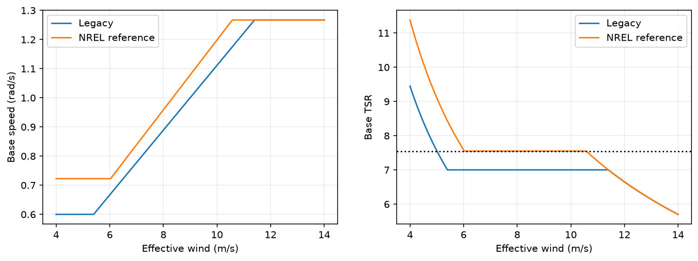
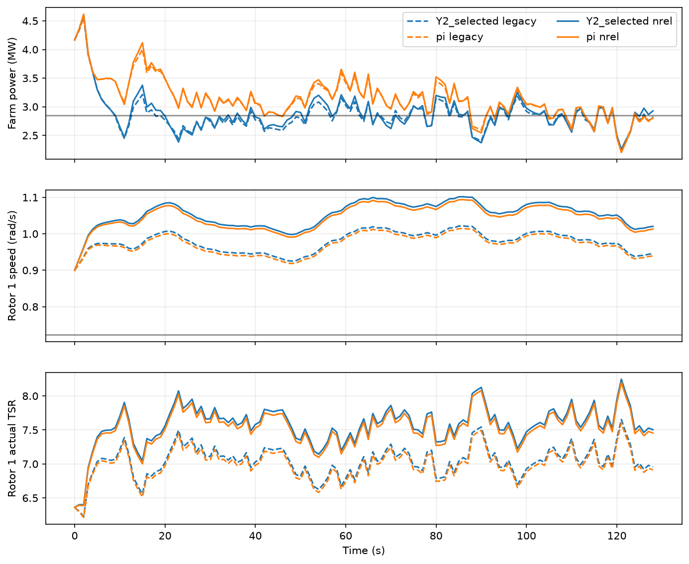

# NREL参考转速：冻结策略迁移结果（2026-11-06）

工程检查已通过。本报告只评估冻结旧策略在新基础曲线和正常运行低限下的迁移，使用旧validation，不是新独立测试或新增训练收益。

## 全部风况族的旧／新对照

RMSE单位kW；Y对三条流及每族两场等权，公共P／PI每场只执行一次。Δ为Y−PI，负值表示Y误差较小。

| 版本 | 风况族 | Y | P | PI | Y−PI |
|---|---|---:|---:|---:|---:|
| legacy | stationary | 457.593402 | 661.104523 | 580.208687 | -122.615285 |
| legacy | ramp | 404.168682 | 658.941740 | 511.380788 | -107.212106 |
| legacy | gust | 270.412586 | 450.063517 | 357.944270 | -87.531684 |
| legacy | overall | 377.391556 | 590.036593 | 483.177915 | -105.786359 |
| nrel | stationary | 519.056561 | 717.492090 | 644.812561 | -125.755999 |
| nrel | ramp | 461.285364 | 697.461378 | 559.755739 | -98.470375 |
| nrel | gust | 292.199091 | 469.039797 | 384.959267 | -92.760176 |
| nrel | overall | 424.180339 | 627.997755 | 529.842522 | -105.662183 |

## 全部30个新回合的配对变化

新−旧为负表示新设置误差下降。没有删除不利回合，也没有依据这些结果重选权重或调曲线。

| 控制器 | 旧validation场景 | 旧RMSE kW | 新RMSE kW | 新−旧 kW |
|---|---|---:|---:|---:|
| Y0_selected | val_stationary_2850000 | 431.925578 | 476.607409 | 44.681832 |
| Y0_selected | val_stationary_3450000 | 500.908455 | 591.793935 | 90.885480 |
| Y0_selected | val_ramp_2850000 | 508.778098 | 557.021663 | 48.243565 |
| Y0_selected | val_ramp_3450000 | 319.912899 | 407.830729 | 87.917830 |
| Y0_selected | val_gust_2850000 | 326.097832 | 341.776231 | 15.678399 |
| Y0_selected | val_gust_3450000 | 251.589186 | 261.885884 | 10.296697 |
| Y1_selected | val_stationary_2850000 | 431.089397 | 475.745392 | 44.655995 |
| Y1_selected | val_stationary_3450000 | 483.779706 | 561.042677 | 77.262971 |
| Y1_selected | val_ramp_2850000 | 445.903285 | 508.679089 | 62.775805 |
| Y1_selected | val_ramp_3450000 | 383.561816 | 426.015586 | 42.453771 |
| Y1_selected | val_gust_2850000 | 310.606970 | 330.006221 | 19.399251 |
| Y1_selected | val_gust_3450000 | 221.619197 | 255.824990 | 34.205793 |
| Y2_selected | val_stationary_2850000 | 418.962111 | 454.619880 | 35.657768 |
| Y2_selected | val_stationary_3450000 | 478.895163 | 554.530074 | 75.634911 |
| Y2_selected | val_ramp_2850000 | 443.809897 | 507.383876 | 63.573978 |
| Y2_selected | val_ramp_3450000 | 323.046095 | 360.781241 | 37.735146 |
| Y2_selected | val_gust_2850000 | 298.714669 | 315.267623 | 16.552954 |
| Y2_selected | val_gust_3450000 | 213.847662 | 248.433598 | 34.585936 |
| p | val_stationary_2850000 | 701.178575 | 742.456568 | 41.277992 |
| p | val_stationary_3450000 | 621.030471 | 692.527613 | 71.497143 |
| p | val_ramp_2850000 | 721.260296 | 764.360675 | 43.100379 |
| p | val_ramp_3450000 | 596.623185 | 630.562081 | 33.938896 |
| p | val_gust_2850000 | 547.607705 | 561.094161 | 13.486456 |
| p | val_gust_3450000 | 352.519329 | 376.985433 | 24.466104 |
| pi | val_stationary_2850000 | 595.188255 | 650.575269 | 55.387014 |
| pi | val_stationary_3450000 | 565.229119 | 639.049852 | 73.820733 |
| pi | val_ramp_2850000 | 612.751414 | 670.825670 | 58.074255 |
| pi | val_ramp_3450000 | 410.010162 | 448.685808 | 38.675647 |
| pi | val_gust_2850000 | 441.237850 | 464.255801 | 23.017952 |
| pi | val_gust_3450000 | 274.650691 | 305.662732 | 31.012041 |

## 实际控制与TSR

| 版本 | 控制器 | 平均基础speed | 平均实际speed | 平均实际TSR | 命令触底% | 命令触顶% | 最大speed速率 |
|---|---|---:|---:|---:|---:|---:|---:|
| legacy | Y0_selected | 0.925742 | 0.924342 | 7.004357 | 0.000000 | 0.000000 | 0.029079 |
| legacy | Y1_selected | 0.933110 | 0.931541 | 7.002997 | 0.000000 | 0.000000 | 0.029079 |
| legacy | Y2_selected | 0.937474 | 0.928159 | 6.940653 | 0.000000 | 0.000000 | 0.030392 |
| legacy | p | 0.923289 | 0.921884 | 7.004927 | 0.000000 | 0.000000 | 0.029079 |
| legacy | pi | 0.927086 | 0.925383 | 7.001897 | 0.000000 | 0.000000 | 0.029079 |
| nrel | Y0_selected | 1.001096 | 0.996995 | 7.532076 | 0.000000 | 0.000000 | 0.044127 |
| nrel | Y1_selected | 1.006370 | 1.002214 | 7.531814 | 0.000000 | 0.000000 | 0.044127 |
| nrel | Y2_selected | 1.017625 | 1.005324 | 7.466512 | 0.000000 | 0.000000 | 0.045440 |
| nrel | p | 0.995112 | 0.991135 | 7.533862 | 0.000000 | 0.000000 | 0.044127 |
| nrel | pi | 0.998835 | 0.994550 | 7.530681 | 0.000000 | 0.000000 | 0.044127 |

speed单位rad/s，速率单位rad/s²，原speed速率上限.1；逐回合上下限、TSR范围与边界样本数见`new_case_physical_audit.csv`。实际TSR使用实际speed及当次响应Ueff，基础／命令TSR使用下发时已观测到的Ueff。7.55仅是未限幅基础参考的设计值。

## 版本、审查与费用

Y selected仍为2048／0／2048新增步，C父为0／0／4096。Y第1流仍selected=initial。原父权重、forecast、桨距／偏航、P／PI增益、执行器时间常数／速率及PINN未变。网络、总命令与动作惩罚仍用旧[.6,1.267]坐标，新物理低限单独执行。

实现审查覆盖faeb029；实际审查SHA256 `eb9737e37fc1d49c181b7e2fd2a59f968f909709151a1fcb1a171f2f7f298c6f`，快照见`review_at_performance.md`，允许依据见`review_admission.json`。新增30回合×129=3870 PINN行，前期120 PINN＋40 mock，累计4030；训练／更新／新风／本报告模型查询均0。

旧30个完整回合只引用核验后的原指标和轨迹，出处与SHA见`legacy_reuse.json`／`lock.json`。历史3870行另记，本轮引用费用0。全预算硬限10000行，存储128MiB。工程阶段24项清单通过版本映射复核，没有重复扫描旧1720项归档。

原400／500kW门槛的逐族及总体通过计数见`family.csv`；其含义仍为每条流均值≤400且最差≤500，不能替代学习收益或独立泛化验收。当前曲线没有训练过程，不能把物理轨迹称作训练退化曲线。

## 图与复现

实验目录`optimization_control/experiments/20261106_nrel_speed_transfer/`。固定case4、stream2来自协议预定，不按结果选图。模型输入实际执行量、物理界限及速率已在每回合运行时检查，保存数据报告再次核对命令组合、因果Ueff、奖励坐标和全部指标。

在隔离工作树使用原`.venv/Scripts/python.exe -B -X utf8`执行模块`nrel_speed_transfer performance`、`nrel_speed_transfer_report performance`、`nrel_speed_transfer_delivery`。这些阶段均已执行且采用独占创建，不重复执行或覆盖账本；只读复核使用`nrel_speed_transfer.context()`及保存的CSV／NPZ／JSON。准备／工程不重跑。

现代理合成标签的speed特性依据入口风及旧曲线，新基础参考按各机有效风速计算。结果只说明当前代理内的软件迁移，不把RMSE变化当作NREL物理性能证据；本轮未修改模型或标签。
