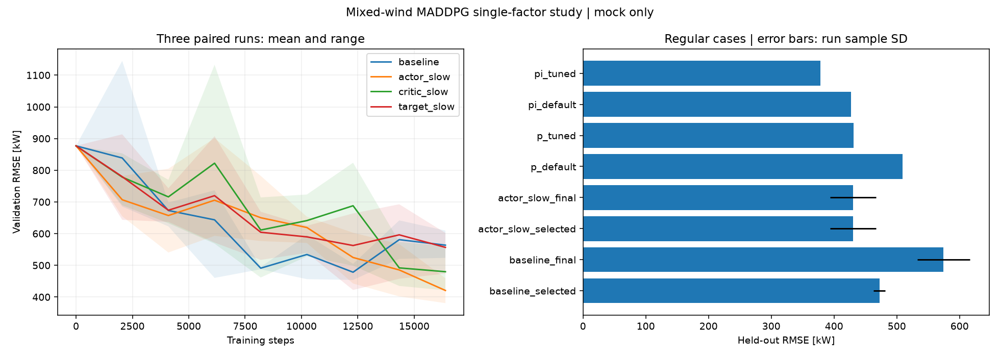

# 混合风况下的 MADDPG 退化诊断与逐因素对照

本任务保留三机 Mock、入口生成器、12/6 PINN 接口、三通道动作和执行器；不改成其他算法。
先检查旧实验验证集上最佳附近与最终检查点，分场景、逐机逐通道记录动作贴边、运动量、
有符号 Q 偏差及同一批状态上一次学习更新的动作变化；对经验回放的终止、目标分布和已施加状态做审计。
这些诊断能定位关联；只有受控单因素实验能够支持相应改动的因果判断，不能声称找到了唯一根因。

## 实验协议（测试前冻结）

- 主种子 42，训练种子沿用派生编号 1/2/3；四个候选使用相同训练来流、目标、预热、探索和预算。
- 基准为上一轮选中配置：合理初始化、奖励乘 100、Actor 3e-4、Critic 1e-3、tau 0.01。
- 三个改动各自仅相对基准改变一项：Actor 1e-4、Critic 3e-4、tau 0.003。
- 每组每个种子训练 16384 步、128 s 回合、每 2048 步验证；四组共 196608 步。
- 全部训练采用固定/平稳湍流/慢变/阵风/变风向混合，目标轮换 2.4/3.0/3.6 MW。
- 新验证/测试随机流采用不同于旧实验的 episode 偏移；各六类、每类六条轨迹，常规目标均衡覆盖上述三档。
- 配置选择按：通过“改善初始且最终/最佳≤1.25”的种子数最多，再取最后三次验证的跨种子均值最低，最后按预声明顺序。
- 每个运行交付检查点仍仅按最低验证 RMSE 选择；同时测试最终策略，不能以最佳模型掩盖后期退化。
- P 验证候选 kp=[0.75,1.5,3.0]；PI 候选相同 kp × ki=[0.04,0.08,0.16]。偏航、转速调度及其余参数固定。
- P/PI 与全部 MADDPG 使用同一验证场景、测试场景、初态、目标、信息来源和执行器；保存原默认和验证选参基线。
- 所有训练完成、配置与基线参数及检查点哈希冻结后，仅测试基准和选中配置的全部三个种子及 P/PI，不按测试表现选种子。
- 新独立测试只用于本轮最终比较；同一确定性 fixed/shortfall 工况允许重复，不声称它们是全新独立物理工况。

稳定性门槛继续保留最终/最佳验证误差≤1.25；固定风测试≤200 kW 的旧门槛只应用于 3 MW 子集，
其他目标分别报告，避免悄悄改变门槛含义。报告三个种子的配对差值、离散程度及逐场景指标，不作显著性承诺。
短缺压力场景不进入选择和常规均值。所有结论只适用于当前未标定 Mock。

## 旧检查点退化诊断

只重放旧验证集，共检查 12 个检查点（每个种子最佳、前后相邻及最终），没有打开旧测试集。
逐机逐通道结果在 [retrospective/metrics.csv](../experiments/20260922_maddpg_retrospective/metrics.csv)。

| 运行 | 最佳→最终验证 RMSE/kW | Q−实际回报均值（最佳→最终） | 桨距贴边比例（最佳→最终） |
|---|---:|---:|---:|
| 1 | 401.37→650.70 | 3.48→10.79 | 33.4%→34.5% |
| 2 | 455.01→542.65 | 3.43→8.30 | 60.6%→87.0% |
| 3 | 390.59→496.59 | 3.73→6.59 | 64.0%→88.2% |

Q 差值在三个 Critic、十条验证轨迹上取平均，正数表示比该次实际回报更乐观。
随机来流下单条回报不是精确条件期望，因此该指标支持价值估计失配的线索，不能独自证明系统性过估计。
第一运行固定风误差从 181.5 升至 485.6 kW；第三运行主要退化在平稳湍流、慢变和阵风。
这排除了“只有随机阵风困难”作为统一解释。

审计结果：末端 transition 的剩余时间为零且终止标记正确；其他 transition 剩余时间为正；
回放 action 与下一观测的 previous command 逐元素一致，实际执行器状态也在观测中。
最终每个回放包含 16384 条 transition，小于容量 20000，无旧数据挤出；三档目标分别 5504/5504/5376 步，
15 种风况×目标组合各 8～9 个回合，没有明显类别缺失或目标比例失衡。
环境未给出风速历史及隐藏的随机来流状态，仍存在部分可观测性，这是建模限制，不在本次改接口。

对每个检查点复制出的 agent，只执行一次诊断更新并比较同一批 256 个回放状态上的动作：
观测到最大归一化单通道变化 0.0962（全跨度 2 的约 4.8%），对应第二运行第 12288 步 T3 转速。
这些操作未保存模型，原检查点哈希保持不变；结果见 `update_probes.csv`。

为避免把“贴边”误判为唯一原因，再做通道干预：最终策略的某一通道替换为旧最佳策略在当前状态上的输出，
其余通道继续使用最终策略。以下均为验证 RMSE/kW，**这些混合策略不作为交付策略，也不参与新实验选模**。

| 运行 | 原最终 | 仅回退偏航 | 仅回退桨距 | 仅回退转速 |
|---|---:|---:|---:|---:|
| 1 | 650.70 | 734.79 | 582.23 | 589.38 |
| 2 | 542.65 | 799.53 | 681.13 | 391.83 |
| 3 | 496.59 | 979.74 | 400.30 | 574.99 |

第二运行回退转速明显改善，第三运行回退桨距改善；全部运行单独回退偏航反而变差。
因此退化与多通道联合策略的变化有关，不能把一个通道的贴边当作统一根因；通道间和闭环状态变化仍会相互影响。
当前 Mock 中，桨距与转速共同决定 `extraction`，再与 `cos(yaw)^2` 一起影响本机功率和下游折减。
多个动作组合可产生相近功率，因此功率误差下降并不唯一确定每个通道应采取的动作。
这是代码中可确认的耦合结构；它解释了为何单通道替换可能破坏配合，但不能替代学习更新机制的对照证据。
干预记录：[channel_rollback/metrics.csv](../experiments/20260922_maddpg_channel_rollback/metrics.csv)。

验证：原 82 项优化侧测试与 7 项旧 PPO 测试通过；新增恢复机制后 6 项受影响测试通过，其中 2 项是新增测试，合计 91 项不同测试通过。新基准第一运行的最终四组网络及经验回放
与旧基准逐元素一致，说明新增评估与独立训练进程未改变基准训练轨迹。
通道干预中的完整 best/final 回放与原验证 RMSE 一致。

## 运行与结果

项目根目录运行以下命令。已有输出目录不覆盖，复现时使用新的目录后缀。

```powershell
& .\.venv\Scripts\python.exe -m optimization_control.maddpg_wind_farm.retrospective --source optimization_control/experiments/20260922_maddpg_stable_training --output optimization_control/experiments/20260922_maddpg_retrospective
& .\.venv\Scripts\python.exe -m optimization_control.maddpg_wind_farm.retrospective --source optimization_control/experiments/20260922_maddpg_stable_training --output optimization_control/experiments/20260922_maddpg_channel_rollback --channel-rollback
& .\.venv\Scripts\python.exe -m optimization_control.maddpg_wind_farm.mixed_stability --output optimization_control/experiments/20260922_maddpg_mixed_stability --workers 3
```

`--workers` 为 1～3 个相互独立的训练进程，每个进程使用单线程 Torch；不共享网络、回放或随机状态。
协议为 `configs/mixed_stability.yaml`，公共训练节奏继承 `configs/stable_training.yaml`；
实际执行参数和完整基础模型配置写入实验顶层 `config.yaml`，每个运行再保存独立配置及归一化参数。
`metrics.csv` 保存全部十二个运行的验证选择结果；`selection.json` 冻结权重哈希、P/PI 参数和选模排序。
`test/metrics.csv` 保存逐轨迹误差、欠功率、运动量、饱和及推理时延；`summary.txt` 和 `test_summary.csv` 汇总结果。
策略和图像只保留本地，Git 保存代码、配置、摘要与顶层指标。中断不会覆盖旧产物。
在尚未冻结选模/开启测试且原训练进程已停止时，给同一研究命令加 `--resume-study` 可恢复：
先核对完整协议和模型配置，保留已完成运行，从 `summary.txt` 已确认的最近检查点恢复未完成运行，
不选择可能只写入一半的更高步数文件。恢复输出写入独立 `_resume_<step>` 子目录，原检查点不覆盖。
本轮会话中断后三个 target_slow 运行从第 12288 步恢复至原定 16384 步；其他九个运行没有重训，P/PI 沿用原验证选参结果。

## 四组配对训练的验证结果

十二次运行全部达到原定 16384 步，共 196608 个环境步。新场景库共 72 条轨迹，
validation/test 各 36 条；常规场景均衡覆盖 2.4/3.0/3.6 MW，因此不能与上一轮仅 3 MW 的均值直接比较。

| 配置 | 后期退化门槛通过数 | 最后三次验证均值/kW | 选择结果 |
|---|---:|---:|---|
| baseline：原配置 | 2/3 | 540.96 | 保留对照 |
| actor_slow：仅 Actor 学习率 1e-4 | 3/3 | 476.92 | 选中 |
| critic_slow：仅 Critic 学习率 3e-4 | 3/3 | 553.22 | 未选中 |
| target_slow：仅 tau=0.003 | 2/3 | 571.77 | 未选中 |

配置选择结果由预先固定的稳定性优先规则产生。actor_slow 的三个运行均在第 16384 步取得本轮最佳验证分数，
说明在本轮预算内未发生最终相对最佳的退化，**不证明继续训练后也会稳定或已经渐近收敛**。
只降低 Critic 学习率也减少了终点退化，但末段跟踪误差较高；放慢目标网络没有普遍改善。
结合配对对照，本轮支持“降低 Actor 更新幅度能改善当前混合任务的训练表现”，不能声称学习率是唯一根因。

P 验证选中 kp=3.0；PI 选中 kp=0.75、ki=0.16，抗饱和及偏航/转速调度保持原配置。
候选表保存在 `baseline_validation.csv`。其选择完全基于验证集，默认参数也保留在独立测试中。

## 独立测试结果与验收

全部策略和 P/PI 参数冻结后运行独立测试，得到 576 行逐轨迹指标，没有依据测试结果重新选择配置、种子或检查点。
下面为五类常规场景的平均 RMSE，± 为三个训练运行的样本标准差，单位 kW；P/PI 无训练随机性。

| 控制器 | 测试平均 RMSE/kW |
|---|---:|
| 原配置，验证选中策略 | 472.40 ± 9.34 |
| 原配置，训练终点策略 | 574.49 ± 42.02 |
| 降低 Actor 学习率，验证选中策略 | 430.21 ± 36.73 |
| 降低 Actor 学习率，训练终点策略 | 430.21 ± 36.73 |
| 默认 P | 509.45 |
| 验证选参 P（kp=3） | 430.97 |
| 默认 PI | 427.42 |
| 验证选参 PI（kp=0.75, ki=0.16） | 378.37 |

改进配置相对原配置的验证选中策略，测试均值降低 8.93%；相对原配置的终点策略降低 25.11%。
三个配对种子的选中策略误差分别降低 44.69、11.09、70.78 kW；终点策略分别降低 183.01、106.43、143.39 kW。
这支持本轮预算与场景中的改进有效，但三个重复不足以证明一般性的统计优势。
改进配置的训练间标准差高于原配置经过验证选择后的标准差，不能把“终点没有退化”泛化为所有稳定性指标都更好。
本轮选中点恰好都是终点，故 selected/final 两行相同，没有事后将较好检查点伪装成终点。

逐场景对照如下（覆盖三档目标；单位 kW）。短缺场景不计入上表常规均值。

| 场景 | 原配置选中策略 | 改进配置 | 验证选参 P | 验证选参 PI |
|---|---:|---:|---:|---:|
| 固定风 | 326.09 | 299.44 | 183.78 | 111.20 |
| 平稳湍流 | 603.53 | 539.63 | 548.60 | 528.25 |
| 慢变化 | 603.26 | 546.49 | 664.16 | 592.96 |
| 阵风 | 485.37 | 454.12 | 574.67 | 548.30 |
| 变风向 | 343.73 | 311.37 | 183.68 | 111.14 |
| 低风高目标压力 | 4082.10 | 4227.63 | 3745.20 | 3745.20 |

改进 MADDPG 在慢变化/阵风中平均误差小于当前验证选参 PI，但综合误差仍高于该 PI，
固定风与变风向仍明显较弱，低风高目标压力表现也未改善。欠功率未通过降低目标或删除失败轨迹来掩盖。

常规场景平均每回合三机累计机舱运动量：原选中策略 1.370 rad、改进策略 1.463 rad、选参 PI 0.291 rad；
桨距累计运动量分别 0.997/1.037/1.118 rad；转速累计变化量分别 7.023/5.778/1.703 rad/s。
改进并非所有控制代价都下降，且这些指标不是疲劳载荷。

完整验收仍为 **未通过**：

| 改进配置运行 | 最终/最佳验证误差比 | 固定风 3 MW 测试 RMSE/kW | ≤200 kW |
|---|---:|---:|---|
| 1 | 1.000 | 226.65 | 未通过 |
| 2 | 1.000 | 121.52 | 通过 |
| 3 | 1.000 | 243.89 | 未通过 |

后期退化门槛三次均通过，但两个种子的固定风精度超过原定门槛，故 `full_stability_gate_passed=false`。
本任务完成了诊断、逐因素实验和独立验证，证明降低 Actor 学习率在本轮有收益；没有实现全部工程门槛或超过强 PI 基线。
没有放宽门槛，也没有在打开测试后再次调参。

交付三份改进策略：`actor_slow_run_1/step_00016384.pth`、`actor_slow_run_2/step_00016384.pth`、
`actor_slow_run_3/step_00016384.pth`，各目录有 `normalization.json`。全部保留，未按测试成绩挑选种子。
对真实 PINN 不作收益承诺；剩余问题是固定工况精度、低风高目标行为及更长训练预算下的表现。


