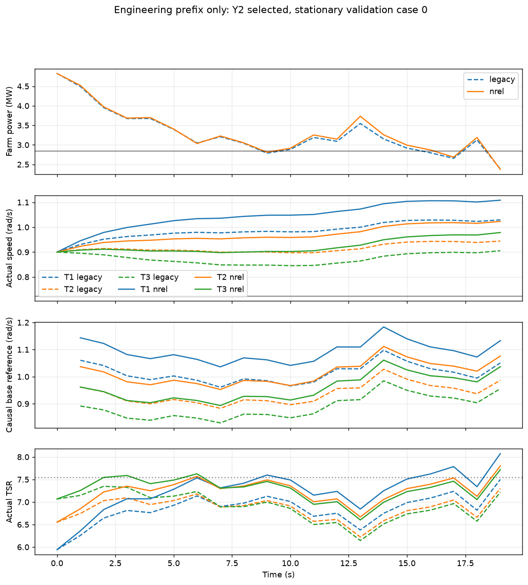

# NREL参考转速迁移：工程交付（2026-11-06）

**工程检查通过，正式迁移性能对照尚未执行。** 本轮新增120行PINN输入与40行mock输入，含reset共160行；训练步数、优化器更新、新风生成均为0。独立审查当前仅完成设计审查，仍为“实现待核查”，因此按冻结协议交接工程产物，停在正式对比之前。不能据这些短前缀判断新曲线改善或损害完整回合精度，也不能据此判断是否需要重训。

本轮工作树为 `.`，分支 `codex/speed-nstep-engineering-20261028`。先行协议提交为 `11ba03d18be653fe0f10b2d020ede55ce4561984`，开始时干净，起点为 `a98ef917f7826c553065163b26c81201655e495f`。原工作区、pitch工作区、共享状态、PINN及旧已验收阶段均未写入。

## 实现与兼容

基础参考为 `clip((7.55/63)*U_eff_i, .7225663103256524, 1.267)` rad/s；每机分别使用当前已观测响应中的有效风速。固定Y的speed修正仍为±.1 rad/s，加入基础参考后统一裁剪。P／PI使用同一函数和最终物理边界，原反馈增益不变。R=63 m、6.9 rpm及7.55的来源和适用条件见[NREL官方报告表1-1、7.2节和表7-2](https://www.nlr.gov/docs/fy09osti/38060.pdf)。7.55仅是本次基础参考的设计值，限幅、变桨、限功率和执行器滞后下的实际TSR应由实际量计算。

私有版本为 `nrel_speed_transfer_old_coordinates_v1`。环境观测、网络输入、归一化命令和动作变化惩罚仍用旧speed坐标[.6,1.267]；新的正常运行低限单独作用于最终命令和原执行器。观测0起索引4／7即第5／8列，继续表示实际speed和上一条实际执行speed总命令的旧坐标。这使原15MW误差归一化、reward_scale100、action_change_weight.001及同物理变化的动作惩罚保持原定义。

原父策略的online／target调度参数、pitch和yaw网络、forecast及权重不变。实际推理先调用冻结策略，再只替换最终speed基础参考；本轮没有target bootstrap或新回放路径，适配器拒绝update。yaw仍控制机舱朝向，失配角由朝向和来流方向计算；原速率、时间常数与物理推进均沿用。

实际权重身份仍为Y selected新增2048／0／2048步，C speed父0／0／4096步。Y第1流仍selected=initial，C前两流仍没有新增speed学习；工程接通不增加其学习收益记录。

## 工程结果

纯函数检查覆盖单位、斜率、低／高限交点6.029361265／10.572317881 m/s、未限幅基础TSR、三机不同风速、零／正／负修正及统一裁剪。同一输入的pitch／yaw命令与原策略逐值一致，旧模式全部组合动作一致。在线／target yaw头、speed头和父online／target入口均检查旧坐标和冻结来源。

三点映射覆盖新低限、.9、1.267 rad/s。解码后分别为.7225663213133813、.8999999989904464、1.267，最大误差1.10e-8 rad/s；新下端命令取朝范围内的float32可表示值。PINN输入自身的float32转换使用1e-7 rad/s数值容差，执行器物理状态的边界使用1e-12。

以下为原stationary validation第0场的19步前缀，horizon仍为128；每次含reset20行。范围包含初态，速率单位rad/s²，允许上限为.1。新设置轨迹发生改变属于配置迁移的正常结果。

| 冻结策略 | 旧模式逐值复现 | 旧实际speed范围 rad/s | 新实际speed范围 rad/s | 旧／新最大speed速率 |
|---|---|---:|---:|---:|
| Y0 selected | 通过 | .858537～1.022323 | .900000～1.100491 | .029079／.044127 |
| Y1 selected=initial | 通过 | .858935～1.022713 | .900000～1.100939 | .029079／.044127 |
| Y2 selected | 通过 | .845322～1.029496 | .897729～1.108527 | .030392／.045440 |

三流旧前缀的动作、物理量、功率、奖励和记录字段均与各自已保存完整旧轨迹逐值相等。新前缀的命令／实际speed处于新范围，机舱朝向、pitch、speed限速均通过，PINN收到实际执行量且未越登记输入域。每回合前后参数摘要、步数／更新／回放计数不变。两个相同19步mock回合的完整轨迹、观测、模型输入和归一化metadata逐值一致。



图只覆盖工程19步前缀，不能解释为训练曲线、完整回合收益或新的独立测试。

## 产物与预算

实验目录为 `optimization_control/experiments/20261106_nrel_speed_transfer/`。主要证据：

- `config.yaml`、`lock.json`：参数、110项来源保护和固定策略身份。
- `pure.json`、`engineering.json`、`engineering_saved_audit.json`：纯函数、闭环、reset及保存数据复核。
- `engineering_metrics.csv`、`engineering_trajectories.csv`、`engineering/*.pt`：六条前缀、模型实际输入和完整观测。
- `legacy_reuse.json`：30个旧完整回合的出处和SHA，核验了风、目标、初态、身份及原指标。原费用3870行，本轮复用费用0行。
- `model_budget.json`：8个已完成scope，120 PINN＋40 mock=160，失败／重试0；硬限10000行。
- `review_at_engineering.md`、`review_status.json`：实际读到的设计审查快照及其摘要。
- `delivery_audit.json`、`output_manifest.csv`、`summary.txt`：旧阶段保持、来源检查、大小、SHA及当前状态。完整对照的`metrics.csv`尚未产生，工程指标单列，避免混称正式性能结果。

交付审计逐项核验了原独立测试1720项输出及原90项保护，全部保持。当前25份实验产物合计1,042,179字节，约.994MiB，低于128MiB硬限；所有工程scope已完成，没有后台训练或待恢复训练。工程指标CSV随本地提交单独保留。

## 复现和下一步

以下命令均在本隔离工作树执行，Python为原工作区`.venv/Scripts/python.exe`，配合`-B -X utf8`。runner自行激活原PINN运行时。准备和工程已执行，产物采用独占创建；不要对现有目录重复执行prepare／engineering或覆盖账本。

```text
python -B -X utf8 -m optimization_control.maddpg_wind_farm.nrel_speed_transfer prepare
python -B -X utf8 -m optimization_control.maddpg_wind_farm.nrel_speed_transfer engineering
python -B -X utf8 -m optimization_control.maddpg_wind_farm.nrel_speed_transfer_report engineering
```

只读核对可调用 `nrel_speed_transfer.context()`，逐项检查来源SHA；读取`engineering.json`／`model_budget.json`核对160行和更新0。只读核对不会构建模型或推进环境。

**唯一后续建议：完成这三个私有实现文件及工程证据的独立代码审查，再执行既定六风况冻结迁移对照。** 当前审查路径为 `./optimization_control/maddpg_wind_farm/NREL_SPEED_REVIEW_20261106.md`，仍写“设计审查完成、实现待核查”。依据[冻结协议](NREL_SPEED_TRANSFER_PROTOCOL.md)“正式性能对照须读取当前实现无实质阻断结论”，没有创建允许正式评估的`review_admission.json`。

审查通过后沿用现有锁和旧30回合，固定原六条validation实际执行新30回合3870行；累计计划4030行，禁止重新选权重、调曲线或生成新风。届时才能给出旧／新每族和总体RMSE、Y−PI、新−旧配对差、400／500kW原精度门槛以及是否需要重训的判断。该对照仍属于冻结策略迁移评估，不是新独立泛化验收，不改写旧阶段结论。

当前代理的合成转速标签依据入口风与旧曲线，和新参考按各机有效风速的假设不同。后续结果只能说明冻结代理内的软件响应，不能自动解释为NREL物理优化收益。本轮不修改该模型或标签。
