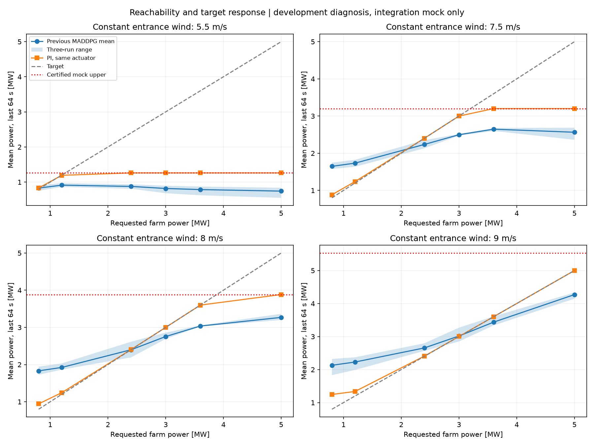
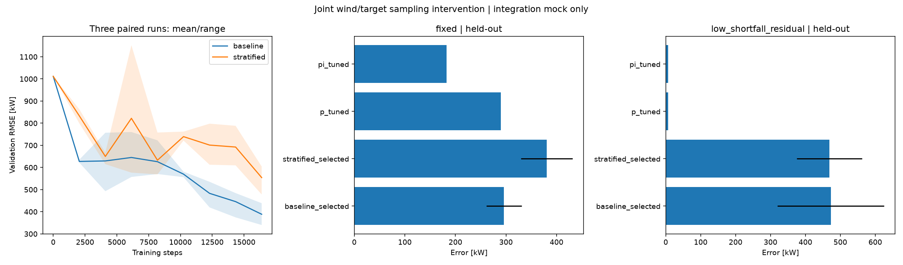

# 功率可达性、误差分解与针对性改进

**结果（2026-09-23 收尾）：诊断与 98,304 步多种子验证完成；分层采样干预未通过，保留原训练方案。**
它使三个种子的常规和固定目标误差均增加，低风压力的平均剩余欠功率只降低 0.8%，且两个种子变差。
本轮不是成功的算法性能改进；代码保留为显式可选的对照实验，不启用为默认配置。

先在当前三机 Mock 中检查固定来流、多功率目标和低风高目标行为，再据诊断确定唯一改动。
不把数值搜索失败当作不可达证明；可行运行点仅证明稳态可达，不保证执行器下一步即可到达。
目标保持外部给定、回合内固定，所有控制器继续共享执行器。
诊断工况、训练/验证工况和最终独立测试各自标记；测试不用于改进选择。

## 可达性方法与实验结果

诊断已完成：24 个固定风速/目标组合中，17 个构造出稳态可行运行点，7 个目标超过已证明上界。
8 m/s 模型最大功率约 3.884 MW，3/3.6 MW 可达而旧 MADDPG 后段仍欠功率；
5.5 m/s 上限约 1.262 MW，5 MW 目标虽不可达，旧策略仍有约 0.49 MW 平均额外欠功率。
同执行器 PI 与可行运行点回放在可达场景后段接近目标，执行器过渡不能单独解释旧策略后段误差。
0.8/1.2 MW 及持续低风高目标没有纳入旧训练任务；其失败不能直接当作算法实现错误。

## 诊断后预先固定的单因素实验

唯一干预是联合风速/目标采样：50% 维持原混合风况，25% 固定来流多目标，25% 持续低风。
不修改目标、网络、观测、奖励、执行器、探索调度或学习率；没有专家动作、PI 残差或功率目标截断。
原采样与分层采样各 3 个配对种子，每个 16,384 步（合计 98,304 步），主种子 42 派生独立流。
Actor lr=1e-4、Critic lr=1e-3、tau=0.01、reward scale=100，三通道全开。

- 配置：`configs/tracking_study.yaml`；新风况流编号从 170000 开始。
- 验证/测试各 27 场：固定 9、平稳/慢变/阵风/变向各 3、低功率 4、低风高目标 2。
- 固定及低功率测试点已要求具备稳态可行解；高目标单列压力场景。
- 每 2048 步验证，按 fixed/stationary/ramp/gust/direction/low_power 六类等权 RMSE 选检查点，含初始策略。
- P/PI 在同一验证集分别搜索 kp=[0.75,1.5,3]、PI ki=[0.04,0.08,0.16]，保留默认与调参对照。
- 冻结两组所有检查点与 P/PI 参数后，独立测试仅执行一次；每个控制器使用同一轨迹、目标、初始状态、步长和执行器。
- 报告常规五类等权 RMSE、固定/低功率 RMSE、低风压力原始 RMSE、已证明欠功率下限及剩余欠功率；不把 RMSE 做加法拆分。
- 改进接受条件：三个种子 selected 的常规 RMSE 均不增、固定 RMSE 均下降、低风压力剩余欠功率均下降。
- 保留稳定性门槛：验证优于初始，final/selected 验证误差≤1.25，独立固定 3 MW RMSE≤200 kW，三个种子均通过。

所有上界、运行点和结论仅适用于明确检查过的联调 Mock，不能直接用于真实 PINN。剩余欠功率仍包含执行器瞬态，不等于严格可避免误差。

## 上界的依据与误差口径

当前三机 Mock 额定值均为 R=5 MW。令 a_i 为本机提取系数乘 cos²(gamma_i)，则 0≤a_i≤1。
入口风速 U≤11.4 m/s 时，按代码中的顺序耦合公式：

```text
P_farm / [R (U/11.4)^3]
  = a1 + (1-0.12 a1)^3 a2 + (1-0.06 a1)^3 (1-0.12 a2)^3 a3
```

右式对 a1 的偏导不小于 1−0.36−0.18=0.46，对 a2 不小于 0.88³−0.36>0，对 a3 为正。
因此全域上界在 a1=a2=a3=1：`R (U/11.4)^3 [1+0.88^3+(0.94*0.88)^3]`。
零偏航、零桨距和逐机有效风速对应的最优转速，在本诊断控制范围内达到这个值。
上界额外保留 10 W 浮点裕量。U>11.4 时仅使用三机无尾流功率和的宽松上界，不把它当作可达到的最大值。
代码拒绝其他预测器、非恒等模型归一化或不一致额定值；无法构造运行点且未超过上界时标记 `unresolved`。

误差定义 `e(t)=P_farm(t)-P_target`。先取欠功率 `s(t)=max(-e(t),0)`，
已证明不可消除下限 `f(t)=max(P_target-P_upper(t),0)`，剩余量 `r(t)=s(t)-f(t)`。
逐步满足 `s=f+r`，因此**平均欠功率**可加法拆分；RMSE 单独报告，不能用 RMSE 减平均下限称作可控 RMSE。
可行运行点回放依然经过原执行器，前段误差可能存在；这不是无动态约束的最优控制器。

## 旧策略的行为定位

来源为上一轮 `actor_slow` 的三个验证选中策略（均为 16384 步），没有用新测试来诊断。
每回合 128 s，前/后半段各 64 s。下表 MADDPG 指标为三个运行的平均值，单位 kW。

| 固定入口/目标 | 模型最大功率 | MADDPG 前段 RMSE | MADDPG 后段 RMSE | MADDPG 后段平均功率 | PI 后段 RMSE |
|---|---:|---:|---:|---:|---:|
| 8 m/s / 2400 | 3884 | 280.08 | 152.32 | 2398.61 | 6.01 |
| 8 m/s / 3000 | 3884 | 158.90 | 251.86 | 2754.29 | 1.38 |
| 8 m/s / 3600 | 3884 | 451.69 | 565.90 | 3036.13 | 0.52 |
| 5.5 m/s / 5000 | 1261.95 | 4198.80 | 4256.25 | 743.77 | 3738.05 |

1. **可达目标未跟上，且后段变差**：8 m/s、3/3.6 MW 的后段误差高于前段；同执行器 PI 与运行点回放后段接近目标，排除“只要等执行器就会好”的解释。
2. **目标响应被压缩**：8 m/s 时目标从 2.4 增至 3.6 MW，MADDPG 后段平均出力只提高约 0.638 MW。2.4 MW 的平均功率接近目标不代表三个种子均精确跟踪，后段 RMSE 仍为 152.32 kW。
3. **低风压力下反向响应**：5.5 m/s 时目标从 1.2 MW 提高到 5 MW，旧策略后段平均出力反而下降；其输出未转向当前模型的最大功率运行点。
4. **可达性与策略损失并存**：5.5 m/s / 5 MW 已证明下限约 3738.04 kW；MADDPG 平均剩余欠功率约 489.39 kW，PI 约 7.00 kW。这部分不能全部归因于目标不可达。

旧训练只使用 2.4/3/3.6 MW，均风范围 7.5–9 m/s；0.8/1.2 MW 和持续低风高目标属于旧任务外测试。
随机风瞬时可能低于均风范围，因此不能说旧回放中完全没有低风样本。
上述行为支持检查目标/风况覆盖不足，但并未证明它是唯一根因；本轮只验证采样这一项干预。



## 新独立测试结果

两组各三个训练全部完成 16,384 步，没有扩大预算或试验第二种干预。
验证/测试各 27 场，输出 432 行独立测试指标；模型及 P/PI 先冻结，再进行测试。
P 最优 kp=3，PI 最优 kp=0.75、ki=0.16，均由本轮验证集选择。
固定可达测试使用 8.1/8.35/8.8 m/s × 2.4/3/3.6 MW；低功率使用 5.25/5.75 m/s × 0.9/1.0 MW；
低风压力使用 5.25/5.75 m/s、目标 4.5 MW。随机三类和变向场景使用新的冻结轨迹。

单位 kW；MADDPG 的 ± 为三个训练种子的样本标准差。P/PI 是同一批轨迹的确定性回放，不虚构训练重复。
“常规”是 fixed/stationary/ramp/gust/direction 五类等权均值，避免固定场景数较多导致加权偏移。

| 控制方案 | 常规 RMSE | 固定多目标 RMSE | 低功率 RMSE | 低风高目标原始 RMSE | 低风高目标平均剩余欠功率 |
|---|---:|---:|---:|---:|---:|
| 原采样 MADDPG selected=final | 394.26±53.51 | 296.13±34.63 | 135.82±21.97 | 3702.99±152.99 | 472.52±152.84 |
| 分层采样 MADDPG selected | 590.19±56.82 | 380.80±51.03 | 162.77±32.55 | 3699.69±93.26 | 468.72±93.62 |
| 分层采样 MADDPG final | 608.63±71.27 | 399.84±77.41 | 144.87±4.98 | 3722.28±131.61 | 491.16±131.73 |
| 默认 P | 606.91 | 416.98 | 123.17 | 3237.39 | 6.99 |
| 验证选参 P | 489.96 | 289.78 | 95.81 | 3237.39 | 6.99 |
| 默认 PI | 498.37 | 255.15 | 79.31 | 3237.39 | 6.99 |
| 验证选参 PI | 401.03 | 182.86 | 62.27 | 3237.39 | 6.99 |

压力场景的平均已证明欠功率下限对所有控制器相同，为 **3230.22 kW**；剩余量逐步相减后平均，
不是用表中的原始 RMSE 直接相减。P/PI 仍有约 7 kW 瞬态剩余量，而两种 MADDPG 约 470 kW。
原采样常规均值略低于 PI，但固定、低功率和低风压力均弱于 PI；三种子不足以支持统计优势结论。
本轮场景和权重与上一轮不同，394.26 不能与旧报告的 430.21 直接作算法进步比较。

分层采样相对原采样 selected 的逐种子变化如下（正值表示变差）：

| 派生种子运行 | 常规 RMSE 变化 | 固定 RMSE 变化 | 低功率 RMSE 变化 | 低风压力剩余欠功率变化 |
|---|---:|---:|---:|---:|
| 1 | +132.70 | +48.50 | +5.57 | +52.89 |
| 2 | +157.65 | +84.97 | +41.19 | +190.39 |
| 3 | +297.44 | +120.53 | +34.07 | −254.69 |

总体常规误差增加约 **49.70%**，固定误差增加约 **28.59%**；压力剩余量均值的轻微下降不能掩盖种子间反向变化。
原采样三个 selected 均为 16384 步；分层采样分别为 16384、8192、16384 步。
分层采样 final/selected 验证比为 1.000、1.063、1.000，均通过后期退化 1.25 门槛；
但固定 3 MW 测试 RMSE 为 248.70、238.20、275.75 kW，**200 kW 门槛 0/3 通过**。
原采样对应为 225.78、226.94、221.57 kW，也为 0/3。单项改进接受条件与完整稳定性门槛均失败。

按固定测试目标拆看后半段平均有符号误差：原采样在 2.4/3/3.6 MW 分别为 +120.54/−122.23/−365.11 kW，
分层采样变为 +464.10/+87.87/−304.34 kW。它略减高目标欠功率，却大幅增加低目标过发，
因此不是统一改善跟踪；PI 对应仅 +5.73/+1.78/+0.33 kW。完整逐场前后段 RMSE 见 `test/metrics.csv`。

本次干预表明：在相同步数、原奖励与网络设置下，增加这些训练工况并不足以纠正失效行为。
新增压力回合会改变回报和回放分布，同时减少原混合任务训练份额；两者属于同一次采样干预，
本实验不能进一步区分各自贡献，也不能推论所有课程设计均无效。
下一项待验证假设应转向“不可达任务对价值学习的影响及目标条件响应”，另立单因素协议和新测试；本轮不据已查看测试追加调参。



## 验证记录

- 91 项优化模块测试 + 7 项旧 PPO 回归测试，共 98 项不同测试通过；新增测试覆盖解析上界、可行运行点、外部模型拒绝、欠功率分解、采样隔离、场景可达性与族间等权。
- 完整训练、传统基线和测试回放均执行每步执行器速率及模型有效域检查。
- 选中/最终权重、场景清单、测试使用的 selection 哈希核对通过；432 行指标均满足平均欠功率分解恒等式。
- 三个原采样终点的 Actor/Critic 及目标网络与上一轮 actor_slow 权重逐张量完全相同，确认本轮评估扩展没有改变对照训练。
- 图已渲染检查；诊断与试验报告保留失败结果，默认训练配置不改为分层采样。

## 复现与交付边界

在仓库根目录使用项目 `.venv`；下列实验目录已有结果，复跑需使用新目录名：

```powershell
& .\.venv\Scripts\python.exe -m optimization_control.maddpg_wind_farm.reachability --source optimization_control/experiments/20260922_maddpg_mixed_stability --output optimization_control/experiments/20260922_maddpg_reachability_checked
& .\.venv\Scripts\python.exe -m optimization_control.maddpg_wind_farm.tracking_study --output optimization_control/experiments/20260922_maddpg_tracking_study
```

中断恢复在同一命令末尾加 `--resume-study`，只允许原协议和原步数预算，从已完成快照恢复；保留旧目录。
完成并冻结的实验拒绝再次选模/测试。检查点包含模型、优化器、回放、随机状态与归一化配置；同目录 `normalization.json` 用于交付核对。
`test/metrics.csv` 保留逐案例指标，`selection.json` 保留选中/最终模型路径与哈希，`test_summary.csv` 保留分组汇总。
诊断首次输出目录 `20260922_maddpg_reachability` 因重复字段拼接报错保留失败记录；修复后使用 `_checked` 新目录，未改历史训练结果。
