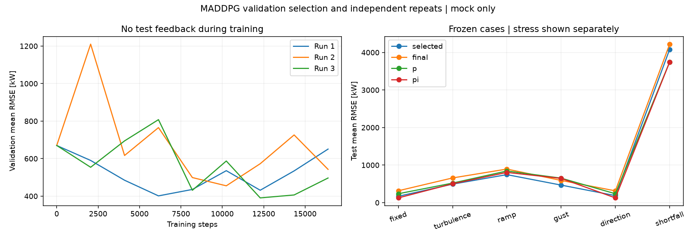

# MADDPG 稳定训练与固定评估流程

本流程只改进训练、选模与评估，保留原 MADDPG 的三个独立 Actor、集中 Critic、目标网络和联合回放。
默认对象仍是未标定 Mock，不能把以下数值验收称为物理控制认证。主种子保持 42，独立运行种子由明确的流编号派生。

## 预先固定的实验协议

配置：`configs/stable_training.yaml`。主对象/执行器配置继承 `configs/stochastic_inflow.yaml`，默认回合 128 s、dt=1 s。
五个筛查配置共用同一网络初始随机流、训练工况及预算；父子配置只改变一个因素：

| 配置 | 相对父配置的唯一改动 |
|---|---|
| original | 原网络初始化、奖励尺度 1、Actor 学习率 3e-4、分通道白噪声 |
| nominal | Actor 最后一层在初始运行点附近初始化 |
| scaled | 完整奖励乘 100，跟踪/动作惩罚相对比例不变 |
| slow_actor | Actor 学习率降至 1e-4，Critic 学习率保持 1e-3 |
| correlated | 白噪声改为各通道不同时间尺度的 AR(1) 噪声 |

所有筛查配置采用相同噪声标准差 `[0.05,0.15,0.08]`，按整个预定预算线性衰减至 20%；
相关噪声时间常数 `[10,3,5]` 秒，稳态方差正确缩放；回合间重置，恢复时保留噪声状态与随机状态。
这套 original 是本轮协议的基准，不声称逐位复现上一轮不同噪声设置的实验。
所有配置仍有相同的均匀随机预热，合理初始化不等于用专家策略代替训练数据。

1. 五种配置各用 8192 步做桨距单通道固定风况筛查；每 2048 步验证，包含第 0 步。
2. 只根据固定风况验证集的最佳 RMSE 选择配置；分数相同取协议中先出现的配置。
3. 对选中配置分别开放桨距+转速、三个通道，各从头训练 8192 步，记录通道扩展表现，不重新调参。
4. 三个独立派生种子从头训练三通道混合风况，各 16384 步。训练回合轮换固定/湍流/慢变/阵风/变风向，目标在回合内固定。
5. 根据各自验证集选出的检查点和最终检查点全部冻结，再一次性运行独立测试集，不根据测试结果重新选配置或种子。

选模规则只接受标记为 validation 的结果，默认拒绝加载 test 集。测试释放文件 `selection.json`
绑定候选配置、全部重复运行及检查点 SHA-256；测试前重新检查场景和权重校验和。
这是可审计的实验边界，不是对可修改代码的用户实施访问安全控制。

## 固定场景库

`bank/manifest.json` 记录版本、主种子、场景 ID、划分、目标和 CSV/JSON 双重校验和。
validation/test 各有六类场景、每类两条轨迹，共 24 条；随机场景使用独立划分流。
固定风的验证点与测试点略有不同。相同确定性短缺压力工况允许重复，划分元数据仍分开。

| 场景 | 内容 | 参与验证选模 |
|---|---|---|
| fixed | 恒定风、3 MW 目标 | 是 |
| stationary | 平稳 Kaimal 湍流 | 是 |
| ramp | 背景慢变化叠加湍流 | 是 |
| gust | 阵风叠加湍流 | 是 |
| direction | 恒定风速、慢变风向 | 是 |
| shortfall | 低风、高目标 | 否，只报告压力表现 |

混合任务按五类场景的平均 RMSE 等权平均选模。指标使用 W，而非不同奖励尺度的原始 return。
短缺压力场景独立列出，防止不可达目标误差主导配置选择。其余随机轨迹不声称每个时刻目标均可达。
所有控制器使用同一轨迹、固定目标、初始运行点、动作权限及执行器。未来风况不进入策略观测。
模型域外、非有限输出或执行器约束违规立即终止，不把失败回合丢弃后继续算漂亮均值。

## 指标与训练诊断

- 每场景：RMSE、MAE、最大绝对误差；欠功率超过目标 2% 的总时长及最长连续时长；平均缺额。
- 控制代价：三机机舱/桨距累计运动量，转速累计变化量；限幅/限速触发比例，命令贴边比例。
- 推理时延：CPU 单线程每次控制器调用的中位数和 P95，包含必要的策略输入检查，排除环境推进。
- 学习诊断：Actor/Critic loss、裁剪前梯度范数、Q 均值、TD 绝对误差；验证起点 Q 与实际折扣回报之差。
- 选模轨迹：每次验证分数、历次最佳分数、最佳步数、最终相对最佳的退化比例。

累计动作不是疲劳载荷；时间指标只描述当前机器上的运行，不代表实时系统认证。
推理时延不参与选模，也不纳入逐位复现断言。三次独立训练报告均值、样本标准差、最小/最大运行均值；
样本数很少，不能仅凭均值宣称统计显著优于 PI。P/PI 直接使用已冻结参数，本轮不额外调参。

## 检查点与恢复

每个验证时刻保存 `step_XXXXXXXX.pth`，包含模型、优化器、回放、网络/采样随机状态、
相关探索噪声、累计回合、验证历史及最佳检查点指针。另存 normalization.json。
原始实验目录和检查点不覆盖。第 0 步也可被选中；若最后仍选初始策略，必须报告“未得到训练改善”。
`summary.txt` 同时指向 best 与 final；不能把 best 当作训练终点或稳定收敛的证明。

Python 调用 `train_run(..., resume=<检查点>, output=<新目录>)` 可续做同一预定预算。
模型、完整协议、训练阶段、种子编号和场景清单哈希必须完全一致；不能中途改变衰减总预算。
标准检查点位于回合边界和验证时刻。验收脚本验证连续/恢复后的网络、回放、探索、验证记录及下一次更新完全一致。

## 运行

在项目根目录执行；输出目录已存在时使用新的日期/后缀：

```powershell
& .\.venv\Scripts\python.exe -m optimization_control.maddpg_wind_farm.stable_workflow --output optimization_control/experiments/20260922_maddpg_stable_training
& .\.venv\Scripts\python.exe -m optimization_control.maddpg_wind_farm.verify_stable --output optimization_control/experiments/20260922_stable_workflow_verification
& .\.venv\Scripts\python.exe -m unittest optimization_control.tests.test_stable_training -v
```

顶层 `config.yaml` 固定完整协议，`metrics.csv` 记录筛查指标，`summary.txt` 汇总独立测试和稳定性门槛；
`test_summary.csv` 保存重复训练的离散程度，`test/metrics.csv` 保存全部场景结果。
各训练目录保留详细验证历史和检查点；`stability.png` 展示验证学习曲线及测试各场景误差。
所有数据与控制接口维持原 12 输入/6 输出约定，真实 PINN 到位后可复用这一流程并重新冻结协议。

## 预先声明的稳定性门槛

全部训练数值有限、在声明域内；每次重复的选中策略严格改善初始验证分数；
选中策略在固定测试风况的平均 RMSE 不超过 200 kW；最终验证分数不超过本次最佳的 1.25 倍。
这些门槛仅用于本轮 Mock 工程检查，未满足时明确报告未达标，不通过放宽门槛改写结果。
是否胜过 PI 是另外的比较问题，不混入数值稳定性验收。

## 2026-09-22 实验结果

训练与固定评估流程已完成，全部实验正常结束；**完整稳定性门槛未通过**，不能把验证选出的较好策略等同于训练稳定收敛。
实验目录：[20260922_maddpg_stable_training](../experiments/20260922_maddpg_stable_training/)。
总训练预算为 106496 个环境步（五组筛查、两组通道扩展、三组独立确认），不含恢复验收的小实验。

单通道筛查结果如下，单位 kW；这些数字来自验证集，不能与后面的混合风况测试均值直接比较。

| 配置 | 最佳验证 RMSE | 最终验证 RMSE |
|---|---:|---:|
| original | 280.54 | 280.54 |
| nominal | 172.17 | 325.71 |
| scaled（选中） | 101.61 | 101.61 |
| slow_actor | 145.48 | 159.19 |
| correlated | 110.57 | 119.35 |

最终冻结的配置采用初始运行点附近初始化、完整奖励乘 100、Actor 学习率 3e-4、分通道衰减白噪声。
本轮没有证据支持将相关噪声或更低 Actor 学习率作为默认改进。
开放桨距+转速后的最佳/最终验证 RMSE 为 134.46/194.11 kW；三通道为 113.04/193.40 kW，
说明增加训练步数不保证改善，后期退化在混合风况确认前已经可见。

独立测试共 144 行记录，覆盖三个重复运行的初始/选中/最终策略，以及固定/P/PI 基线。
下面先对每条轨迹计算 RMSE，再等权平均五类常规场景，最后跨独立训练求均值和样本标准差。
短缺压力场景不进入该均值，保留在逐场景结果和图中。

| 控制器 | 测试平均 RMSE（kW） | 训练间样本标准差（kW） |
|---|---:|---:|
| 初始 MADDPG | 852.73 | 0.18 |
| 验证集选出的 MADDPG | 412.15 | 30.49 |
| 最终训练时刻 MADDPG | 554.60 | 74.31 |
| 固定运行点 | 852.77 | — |
| 三通道 P 组合 | 497.58 | — |
| 三通道 PI 组合 | 441.09 | — |

P/PI 在同一场景库运行一次，不存在训练随机性；表中横线不表示性能不确定性为零。
选中 MADDPG 的测试均值低于当前 PI 基线，但只有一个未标定 Mock、三个训练重复和有限场景，
不能据此宣称统计显著优势、真实风场收益或对所有风况更好。固定风和变风向场景中 PI 仍较好。

| 运行 | 验证选中步数 | 最终/最佳验证误差比 | ≤1.25 门槛 |
|---|---:|---:|---|
| 1（confirm_0） | 6144 | 1.621 | 未通过 |
| 2（confirm_1） | 10240 | 1.193 | 通过 |
| 3（confirm_2） | 12288 | 1.271 | 未通过 |

三个运行的选中策略均改善初始验证分数，且固定测试风况 RMSE 均不超过 200 kW；
但两个运行的后期退化超过预先声明门槛，故 `stability_gate_passed=false`。
流程能复现、能选模、能暴露退化；算法稳定收敛仍是待解决项。
后续优先在训练/验证数据上结合 Q 偏差、梯度和动作贴边记录定位退化，下一轮重新冻结协议与新的独立测试集，
不使用本轮测试结果继续筛选配置或挑选某个种子作为“最好模型”。

交付策略分别位于 `confirm_0/step_00006144.pth`、`confirm_1/step_00010240.pth`、
`confirm_2/step_00012288.pth`；各目录内有对应 `normalization.json`，精确权重哈希保存在 `selection.json`。
三个策略全部保留，不按测试分数二次挑选。模型和图像按项目规范仅保留本地，Git 保存源代码、配置和结果摘要。

验证：78 项优化模块测试及 7 项旧 PPO 测试通过，共 85 项；最终防护调整后重跑 6 项受影响测试通过。
连续 256 步与 128+128 步恢复的网络、回放、探索随机状态、验证记录及下一更新完全一致；
磁盘加载评估一致、场景文件被改动时拒绝加载。
验收记录：[20260922_stable_workflow_verification](../experiments/20260922_stable_workflow_verification/)。


